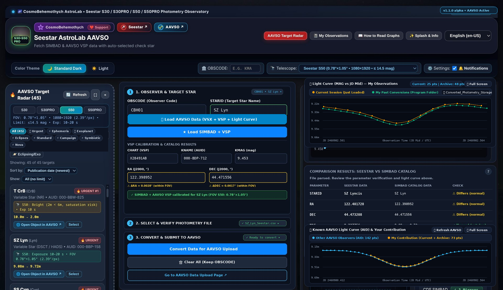
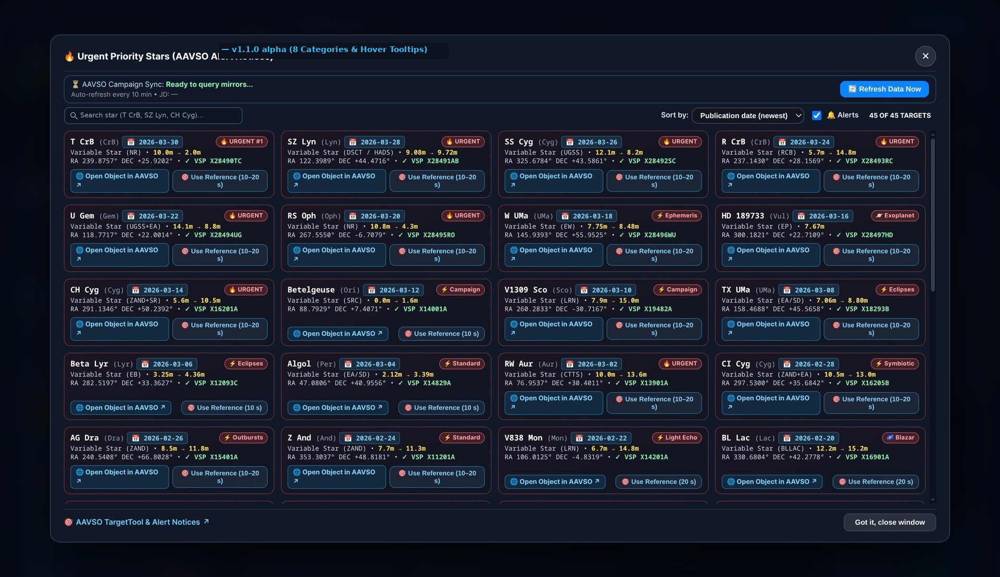
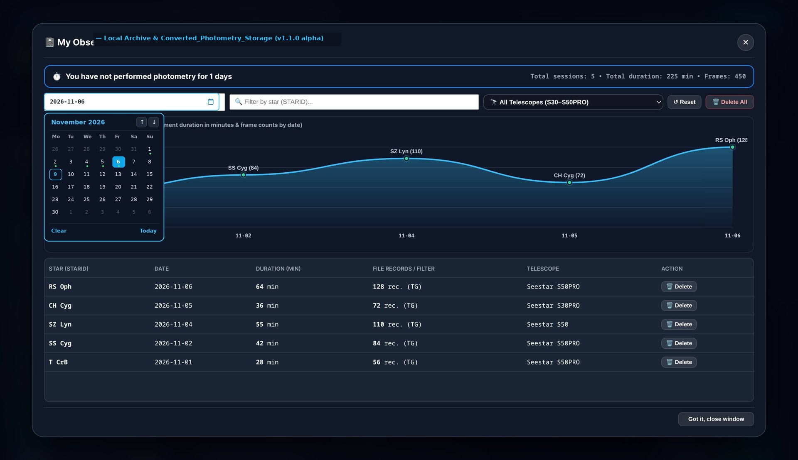
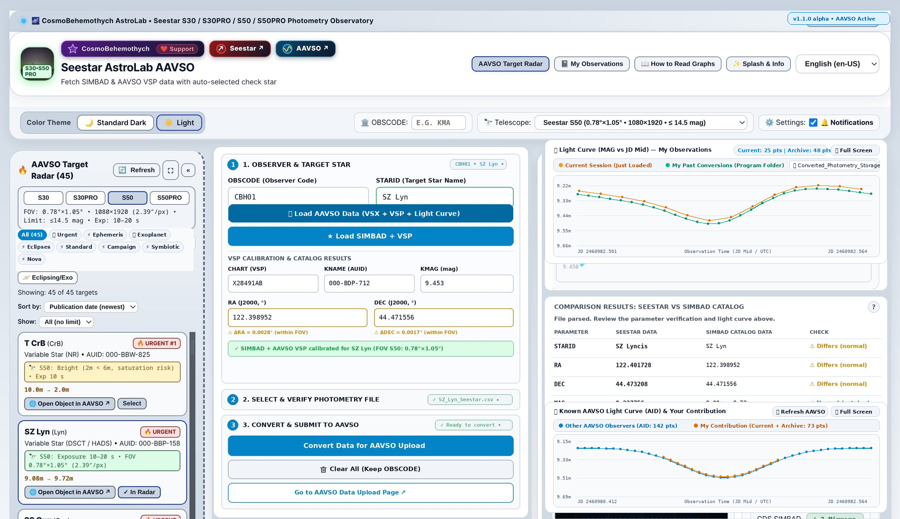
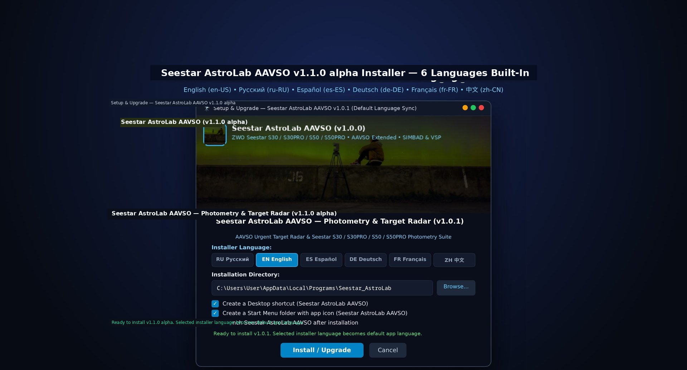

# 🔭 Seestar AstroLab AAVSO (`v1.1.0 alpha` & `v1.0.1 Stable`)

🌟 **Seestar AstroLab AAVSO** is a specialized desktop application for owners of **ZWO Seestar smart telescopes (`S30`, `S30PRO`, `S50`, `S50PRO`)** and variable star observers affiliated with the [AAVSO (American Association of Variable Star Observers)](https://www.aavso.org).

The program bridges the technical gap between the built-in photometry tool of [ZWO Seestar](https://www.seestar.com) telescopes and the scientific [AAVSO WebObs](https://www.aavso.org/webobs) & [AAVSO International Database (AID)](https://www.aavso.org/aavso-international-database-aid): it automatically converts raw Seestar photometric CSV files into the international **AAVSO Extended** standard, verifies star coordinates and identifiers via [AAVSO VSX](https://www.aavso.org/vsx/), [AAVSO VSP (Variable Star Plotter)](https://app.aavso.org/vsp/), and [CDS SIMBAD](https://simbad.cds.unistra.fr/simbad/), automatically selects the optimal check star (`Check Star`: `KNAME` / `KMAG`) within the field of view of each Seestar model, plots multi-layer light curves, maintains a local archive of all your converted sessions (`Converted_Photometry_Storage/`), and includes an interactive **AAVSO Target Radar** with 8 astrophysical object categories.

## 📦 Version Selection (Both Versions Available on GitHub)

We preserve all previous releases in the [GitHub Releases](https://github.com/CosmoBehemothych/Seestar-AstroLab-AAVSO/releases) section and repository so every observer can choose the version that best fits their workflow:

| 🏷️ Version | 📌 Status | ⬇️ Installer / Portable Package | 🔍 Summary |
| ----- | ----- | ----- | ----- |
| **`v1.1.0 alpha`** | 🧪 **New Feature Release (Alpha)** | [`Seestar_AstroLab_Setup_v1.1.0-alpha.exe`](https://github.com/CosmoBehemothych/Seestar-AstroLab-AAVSO/releases/tag/v1.1.0-alpha) / [`Portable/Seestar_AstroLab_Portable_v1.1.0-alpha.exe`](Portable/Seestar_AstroLab_Portable_v1.1.0-alpha.exe) | Direct AAVSO (`VSX` + `VSP` + `AID`) integration, 2 independent light-curve engines (My Observations vs. AAVSO AID + My Contribution), full-screen scrollable curve viewer, local `Converted_Photometry_Storage` archive, 8 Target Radar category filters with tooltips, and harmonized Light/Dark themes |
| **`v1.0.0` / `v1.0.1`** | ✅ **Classic Initial Release** | [Available in GitHub Releases (`v1.0.0`)](https://github.com/CosmoBehemothych/Seestar-AstroLab-AAVSO/releases/tag/v1.0.0) | Original initial release with SIMBAD + VSP synchronization, basic Seestar CSV → AAVSO Extended conversion, and basic target radar |

## 📑 Table of Contents

* [📦 Version Selection](#-version-selection-both-versions-available-on-github)
* [🚀 What's New in v1.1.0 alpha (Compared to GitHub v1.0.0)](#🚀-whats-new-in-v110-alpha-compared-to-github-v100)
* [📸 Screenshots (`v1.1.0 alpha`)](#-screenshots-v110-alpha)
* [✨ Key Features](#-key-features)
* [🔭 Supported Seestar Models](#-supported-seestar-models)
* [🧭 Step-by-Step Guide](#-step-by-step-guide-from-seestar-imaging-to-aavso-webobs-submission)
* [👨‍💻 Authorship & Support](#-authorship--support)
* [🇷🇺 Русская версия (Russian Version)](#-русская-версия-russian-version)

## 🚀 What's New in `v1.1.0 alpha` (Compared to GitHub `v1.0.0`)

1. **🛰️ Direct AAVSO (`VSX` + `VSP` + `AID`) Integration**:
   * Prioritizes official [AAVSO VSX](https://www.aavso.org/vsx/) and [AAVSO VSP](https://app.aavso.org/vsp/) catalogs for target star identification, coordinates (`RA/DEC J2000`), comparison/check star selection (`CHART`, `KNAME`, `KMAG`), and urgent campaign synchronization, with automatic fallback to global CDS SIMBAD/VizieR mirrors.
2. **📈 Two Independent Scientific Light Curve Panels**:
   * **Panel 1 — `📈 Light Curve (MAG vs JD Mid) — My Observations`**: displays exclusively your own photometry — your **Current Session** (`#f59e0b` amber/yellow, compact `2.0 px` points) and **My Past Conversions** loaded from the program's local storage folder (`#10b981` emerald green, compact `1.8 px` points) without mixing external observer data.
   * **Panel 2 — `📊 Known AAVSO Light Curve (AID) & Your Contribution`**: replaces the static star field image with an interactive comparative light curve showing **Other AAVSO Observers** from the [AAVSO International Database (AID)](https://www.aavso.org/aavso-international-database-aid) (`#38bdf8` cyan) alongside **Your Contribution** (current session + local archive).
3. **⛶ Full-Screen Scrollable Light Curve Inspector (`⛶ Full Screen`)**:
   * Both light curve panels feature a **`⛶ Full Screen`** button opening a high-resolution modal with horizontal zoom (`100%`, `200%`, `400%`, `800%`) and vertical height scaling (`520 px`, `820 px`, `1200 px`) plus continuous session time mapping (`JD Mid / UTC` on X, inverted `MAG` on Y) so eclipses and pulsations render as smooth `U`- or wave-shaped curves.
4. **📁 Dedicated Local Archive (`Converted_Photometry_Storage/`)**:
   * Every converted session is automatically saved in the program folder `Converted_Photometry_Storage/` (`user_converted_photometry_db.json` and individual AAVSO Extended files in `sessions/`), allowing you to track how each new observation complements all your previously converted data.
5. **🎯 8 Astrophysical Target Radar Filters with Hover Tooltips**:
   * Replaced the single telescope-limit filter button with 8 specialized category filters in the **AAVSO Target Radar**: **🔥 Urgent**, **⚡ Ephemeris**, **🪐 Exoplanet**, **⚡ Eclipses**, **⚡ Standard**, **⚡ Campaign**, **⚡ Symbiotic**, and **⚡ Nova**, each displaying an educational astrophysical tooltip on hover.
6. **🎨 Harmonized Light & Dark Themes & Instant Workspace Reset**:
   * Eliminated dark/gray blocks in the **Light (`☀️ Light`)** theme, ensured all text wraps cleanly within card boundaries across all 6 languages (`RU | EN | ES | DE | FR | ZH`), and upgraded the **«🗑 Clear All»** button to immediately reset both light-curve panels and full-screen views while preserving your `OBSCODE`.

## 📸 Screenshots (`v1.1.0 alpha`)

### 1. Main dashboard, Seestar → AAVSO Extended photometry converter, 8 radar category filters, and dual light curves (Dark theme)

### 2. Interactive AAVSO Urgent Target Radar (`Alert Notices` & 8 Object Categories)

### 3. "My Observations" section & `Converted_Photometry_Storage` analytics

### 4. Harmonized Light theme and multilingual interface (`Light Theme`)

### 5. Installer menu localized into 6 languages (`RU | EN | ES | DE | FR | ZH`)

## ✨ Key Features

* 🔄 **Direct ZWO Seestar CSV → AAVSO Extended conversion**: automatically calculates mid-exposure Julian Date (`JD_Mid = (JD_Start + JD_End) / 2`), filters target measurements (`Non-reference star`), rounds instrumental `MAG` and uncertainty `MERR` in the `TG` band to 4 decimal places, and generates a valid `#TYPE=EXTENDED` header with your `#OBSCODE`.
* 🔭 **Adapted for all 4 ZWO Seestar models**:
  * **Seestar S30** — FOV `1.28°×0.72°`, photometry limit up to `13.5 mag`
  * **Seestar S30PRO** — FOV `2.10°×1.18°`, 4K sensor, up to `14.2 mag`
  * **Seestar S50** — FOV `0.78°×1.05°`, up to `14.5 mag`
  * **Seestar S50PRO** — FOV `1.15°×0.65°`, 4K sensor, up to `15.2 mag`
* 🛰️ **Synchronization with AAVSO VSX, AAVSO VSP, AAVSO AID, and CDS SIMBAD**: automatic reduction of Latin constellation names according to IAU standards (e.g., `SZ Lyncis` → `SZ Lyn`), retrieval of the official chart identifier (`CHART ID`), and automatic selection of a non-variable check star (`KNAME`, `KMAG`).
* 💾 **Persistent storage of `OBSCODE`, `Converted_Photometry_Storage`, and "My Observations" database**: atomically saves your observatory code `OBSCODE`, converted photometry archive, selected language, and theme across restarts and updates.
* 🌍 **Full localization of the application and installer into 6 languages**: Russian (`ru-RU`), English (`en-US`), Spanish (`es-ES`), German (`de-DE`), French (`fr-FR`), and Chinese (`zh-CN`).

## 🔭 Supported Seestar Models

| 🔭 Model | 📐 Field of View (FOV) | 🌟 Photometry Limit |
| ----- | ----- | ----- |
| Seestar S30 | 1.28° × 0.72° | up to 13.5 mag |
| Seestar S30PRO | 2.10° × 1.18° | up to 14.2 mag |
| Seestar S50 | 0.78° × 1.05° | up to 14.5 mag |
| Seestar S50PRO | 1.15° × 0.65° | up to 15.2 mag |

## 🧭 Step-by-Step Guide (From Seestar Imaging to AAVSO WebObs Submission)

### ⚙️ Step 1: Installation & First Launch (Windows 10 / 11)

1. ⬇️ Choose your preferred version in [Releases](https://github.com/CosmoBehemothych/Seestar-AstroLab-AAVSO/releases) (`v1.1.0 alpha` or classic `v1.0.0 / v1.0.1`) and download **`Seestar_AstroLab_Setup_v1.1.0-alpha.exe`** (or **`Seestar_AstroLab_Setup.exe`**).
2. 🚀 Run the installer, select your preferred language (`RU | EN | ES | DE | FR | ZH`), and click **"Install / Upgrade"**.
3. 💼 Portable builds (`Portable/Seestar_AstroLab_Portable_v1.1.0-alpha.exe` and `Portable/Seestar_AstroLab_Portable.exe`) and the standalone web interface (`Source_and_Build/pwa_mobile_and_electron/index.html`) are also included.

### 👤 Step 2: Observer Profile Setup (One-Time)

1. 🔭 In the top panel, select your telescope model (`S30`, `S30PRO`, `S50`, or `S50PRO`).
2. 🪪 In Section 1 (**"Observer and Star"**), enter your official AAVSO observer code in the **`OBSCODE`** field (e.g., `CBH01`). It is saved automatically and preserved on all subsequent launches and when clicking **"Clear All"**.

### ⭐ Step 3: Target Selection & AAVSO Data Loading

1. 🎯 Filter targets in the **"AAVSO Target Radar"** by category (`Urgent`, `Ephemeris`, `Exoplanet`, `Eclipses`, `Standard`, `Campaign`, `Symbiotic`, `Nova`) and click **"Select"**, or enter a star name in **`STARID`** (e.g., `SZ Lyn`, `T CrB`, `SS Cyg`).
2. 🛰️ Click **"🔭 Load AAVSO Data"** to retrieve `RA/DEC (J2000)`, official `CHART ID`, check star `KNAME` / `KMAG`, and the known AAVSO (AID) light curve.

### 📊 Step 4: CSV Conversion, Local Archive & Submission to AAVSO WebObs

1. 📂 Attach your raw Seestar photometry CSV file in Section 2 (**"Select Seestar CSV File"**).
2. 📈 Inspect your personal light curve in the top chart (**`📈 Light Curve (MAG vs JD Mid) — My Observations`**) and compare your observations against other AAVSO observers in the bottom chart (**`📊 Known AAVSO Light Curve (AID) & Your Contribution`**). Click **`⛶ Full Screen`** on either chart for detailed scrollable analysis.
3. 🔄 Click **"Convert Data for AAVSO Upload"**:
   * 💾 The converted `#TYPE=EXTENDED` file is saved to your computer and archived automatically in `Converted_Photometry_Storage/`;
   * 🌐 Upload the generated file to [AAVSO WebObs](https://www.aavso.org/webobs).

## 👨‍💻 Authorship & Support

* 🧑‍🚀 **Developer**: **CosmoBehemothych** (<https://github.com/CosmoBehemothych>)
* 🛡️ **Anti-Plagiarism Fingerprint**: `CBH-ASTROLAB-AAVSO-2026-9F8E4A21-7C3D-B601` (see [AUTHORSHIP_AND_COPYRIGHT_PROOF.md](Source_and_Build/docs/AUTHORSHIP_AND_COPYRIGHT_PROOF.md))
* ☕ **Support the project on Boosty**: <https://boosty.to/cosmobehemothych>

## 🇷🇺 Русская версия (Russian Version)

> 📸 Скриншоты интерфейса `v1.1.0 alpha` — см. выше в разделе [📸 Screenshots (`v1.1.0 alpha`)](#-screenshots-v110-alpha).

🌟 **Seestar AstroLab AAVSO** — специализированное десктопное приложение для владельцев умных телескопов **ZWO Seestar (`S30`, `S30PRO`, `S50`, `S50PRO`)** и наблюдателей переменных звёзд [AAVSO (American Association of Variable Star Observers)](https://www.aavso.org).

### 📦 Выбор удобной версии на GitHub (Сохранены обе версии)

При обновлении репозитория старая версия **не удаляется** — в разделе [Releases на GitHub](https://github.com/CosmoBehemothych/Seestar-AstroLab-AAVSO/releases) и в дереве репозитория доступны обе сборки, чтобы каждый пользователь мог выбрать удобную для себя версию:

| 🏷️ Версия | 📌 Статус | ⬇️ Установщик / Portable-сборка | 🔍 Описание версии |
| ----- | ----- | ----- | ----- |
| **`v1.1.0 alpha`** | 🧪 **Новая расширенная сборка (Alpha)** | [`Seestar_AstroLab_Setup_v1.1.0-alpha.exe`](https://github.com/CosmoBehemothych/Seestar-AstroLab-AAVSO/releases/tag/v1.1.0-alpha) / [`Portable/Seestar_AstroLab_Portable_v1.1.0-alpha.exe`](Portable/Seestar_AstroLab_Portable_v1.1.0-alpha.exe) | Прямая интеграция с AAVSO (`VSX` + `VSP` + `AID`), 2 независимых графика кривой блеска (Мои наблюдения + Известная кривая AAVSO и Ваш вклад), полноэкранный режим со скроллом, локальное хранилище `Converted_Photometry_Storage`, 8 категорий фильтра Радара целей со всплывающими подсказками и обновлённая светлая тема |
| **`v1.0.0` / `v1.0.1`** | ✅ **Классическая первая версия** | [Доступна в разделе Releases (`v1.0.0`)](https://github.com/CosmoBehemothych/Seestar-AstroLab-AAVSO/releases/tag/v1.0.0) | Базовая первоначальная версия с синхронизацией SIMBAD + VSP и классическим конвертером CSV → AAVSO Extended |

### 🚀 Что нового в версии `v1.1.0 alpha` по сравнению с версией `v1.0.0` на GitHub

1. **🛰️ Прямая интеграция с каталогами и базой кривых блеска AAVSO (`VSX` + `VSP` + `AID`)**:
   * Загрузка координат, параметров переменности, официальных карт сравнения (`CHART ID`), контрольных звёзд (`KNAME`, `KMAG`) и срочных кампаний напрямую через сервисы [AAVSO VSX](https://www.aavso.org/vsx/) и [AAVSO VSP](https://app.aavso.org/vsp/) с резервированием через зеркала CDS SIMBAD / VizieR.
2. **📈 Два независимых блока кривых блеска с цветовым разделением слоёв**:
   * **Блок 1 — `📈 Кривая блеска (MAG vs JD Mid) — Мои наблюдения`**: отображает исключительно ваши собственные результаты — **текущую загруженную сессию** (жёлто-оранжевый цвет `#f59e0b`, компактные точки `2.0 px`) и **ваши прошлые конвертации** из папки программы `Converted_Photometry_Storage` (зелёный цвет `#10b981`, компактные точки `1.8 px`), без смешивания с чужими данными из AAVSO.
   * **Блок 2 — `📊 Известная кривая блеска AAVSO (AID) и Ваш вклад`**: вместо статичного снимка звезды подтягивает известную кривую блеска из базы [AAVSO International Database (AID)](https://www.aavso.org/aavso-international-database-aid) (выделена голубым цветом `#38bdf8` — наблюдения других участников AAVSO) и накладывает поверх неё **ваш личный вклад** (текущая сессия + ваш архив конвертаций). При первом запуске и после очистки блок аккуратно предлагает загрузить данные по звезде и приложить собственный файл Seestar.
3. **⛶ Полноэкранный просмотр графиков со скроллом (`⛶ На весь экран`)**:
   * В обоих блоках кривой блеска добавлена кнопка **`⛶ На весь экран`**, открывающая детальное окно анализа с масштабированием по ширине (`100%`, `200%`, `400%`, `800%`) и высоте (`520 px`, `820 px`, `1200 px`), горизонтальным/вертикальным скроллом и непрерывной шкалой времени сессий (`JD Mid / UTC` по оси X, перевёрнутый блеск `MAG` по оси Y), благодаря чему кривая блеска отображается в естественной форме `U`-образного провала или волны, а не сжатыми вертикальными полосами.
4. **📁 Отдельный раздел хранения прошлых конвертаций в папке программы (`Converted_Photometry_Storage/`)**:
   * Все сконвертированные вами данные автоматически сохраняются на компьютере в папке `Converted_Photometry_Storage/` (`user_converted_photometry_db.json` и папка `sessions/`). Текущая сессия до момента нажатия кнопки конвертации не дублируется в архив прошлых конвертаций.
5. **🎯 8 категорий объектов в панели Радара целей со всплывающими подсказками**:
   * Вместо кнопки фильтра под модель телескопа добавлены кнопки выбора категорий: **🔥 Срочно**, **⚡ Эфемериды**, **🪐 Экзопланета**, **⚡ Затмения**, **⚡ Эталон**, **⚡ Кампания**, **⚡ Симбиотическая**, **⚡ Новая**. При наведении курсора на любую кнопку всплывает подробная астрофизическая подсказка с описанием данного класса объектов.
6. **🎨 Гармоничная светлая тема (`☀️ Light`), адаптивные границы текста и полная очистка**:
   * Полностью устранены серые и чёрные блоки в светлой теме, проверено вписывание текста в границы всех карточек и окон во всех 6 локализациях (`RU | EN | ES | DE | FR | ZH`), а нажатие кнопки **«🗑 Очистить»** мгновенно сбрасывает оба графика, полноэкранное окно и статусные плашки (сохраняя ваш `OBSCODE`).

### ❤️ Авторство и поддержка проекта

* 🧑‍🚀 **Разработчик**: **CosmoBehemothych** (<https://github.com/CosmoBehemothych>)
* 🛡️ **Цифровой отпечаток авторства (Anti-Plagiarism Fingerprint)**: `CBH-ASTROLAB-AAVSO-2026-9F8E4A21-7C3D-B601` (подробная документация — в файле [AUTHORSHIP_AND_COPYRIGHT_PROOF.md](Source_and_Build/docs/AUTHORSHIP_AND_COPYRIGHT_PROOF.md))
* ☕ **Поддержать развитие проекта на Boosty**: <https://boosty.to/cosmobehemothych>
