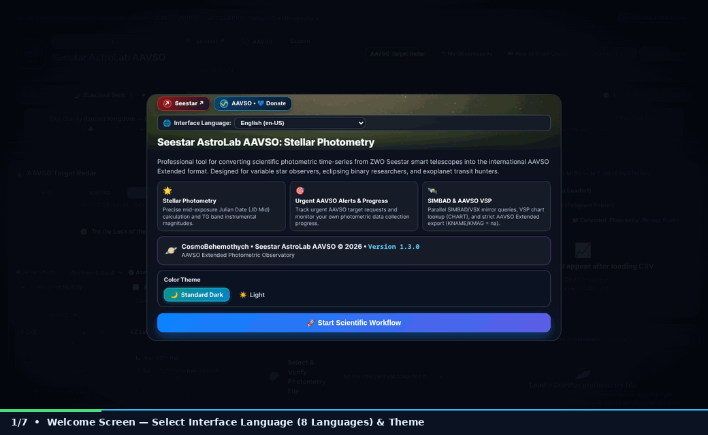
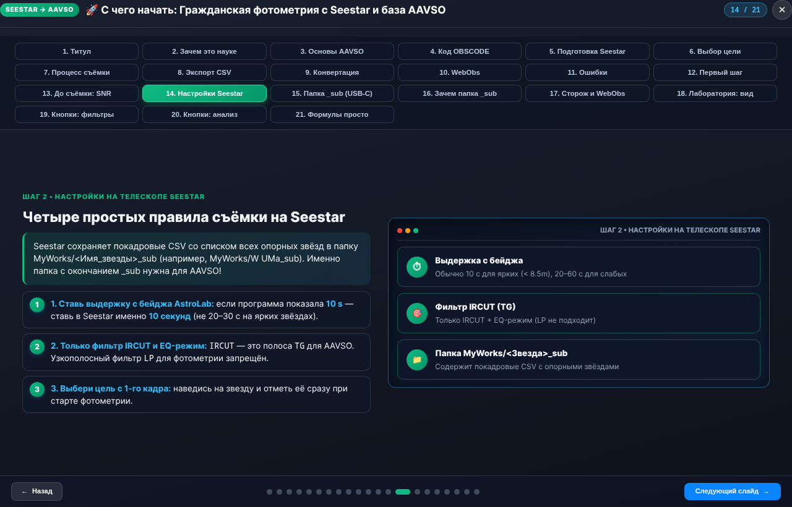

# 🔭 Seestar AstroLab AAVSO (`v1.3.4`)

[-10b981?style=flat-square)](#-languages--feedback)

> **Turn your ZWO Seestar (`S30`, `S30PRO`, `S50`, `S50PRO`) into a scientific photometry instrument: convert raw `Magnitude_*.csv` files into verified, upload-ready [AAVSO WebObs](https://www.aavso.org/webobs) reports in 15 seconds.**  
> **Important:** We **do NOT send photos or telescope images** — only brightness measurements (small CSV numbers) are submitted to the [AAVSO International Database (AID)](https://www.aavso.org/aavso-international-database-aid).

**[⬇️ Download Latest Release (`v1.3.4` — Windows Installer)](https://github.com/CosmoBehemothych/Seestar-AstroLab-AAVSO/releases/tag/v1.3.4)** • **[🛡️ Verify SHA-256 (`VERIFY.txt`)](VERIFY.txt)** • **[🇷🇺 Русская версия ниже](#-русская-версия-russian)**

---

## 🎬 Quick Demo: Raw Seestar CSV → AAVSO Extended Report

---

## 🚀 Getting Started in 3 Simple Steps

1. **⬇️ Download** **`Seestar_AstroLab_Setup_v1.3.4.exe`** (Windows Installer) and **`SHA256SUMS.txt`** from [GitHub Releases](https://github.com/CosmoBehemothych/Seestar-AstroLab-AAVSO/releases/tag/v1.3.4). *(Portable builds are discontinued — only the standalone Windows Installer is supported.)*
2. **▶️ Install & Launch** the app (no Python installation required; all libraries are bundled inside).
3. **🟢 Click the green `🚀 Getting Started` button** in the top bar — a built-in **12-slide visual guide** (available in all **8 languages**) walks you step by step from registering a free [AAVSO `OBSCODE`](https://www.aavso.org/user/register) and shooting `EQ Mode` photometry on your Seestar to uploading your finished CSV report to [AAVSO WebObs](https://www.aavso.org/webobs).

---

## 📦 Versions & Download

| Version | Status | Download Link | Highlights |
| :--- | :--- | :--- | :--- |
| **`v1.3.4`** | ✨ **Latest Release** | [GitHub Releases (`v1.3.4`)](https://github.com/CosmoBehemothych/Seestar-AstroLab-AAVSO/releases/tag/v1.3.4) | Responsive Sky Clarity & Moon header widgets (zero clipping on narrow/scaled windows), full keyboard date entry (`DD.MM.YYYY`) in My Observations, redesigned 8-slide **How to Read AAVSO Light Curves** guide in 8 languages (bands `TG/V/CV/Vis.`, `MERR`, pulsators, eclipses, upper limits, saturation & pre-upload checklist), Playwright CI regression gate & 4 mandatory autotests |
| **`v1.3.1`** | 📦 **Previous Release** | [GitHub Releases (`v1.3.1`)](https://github.com/CosmoBehemothych/Seestar-AstroLab-AAVSO/releases/tag/v1.3.1) | **Windows Installer only** + `SHA256SUMS.txt` & `VERIFY.txt` in every release, CI pre-build regression autotests, per-row `Mag Error (MERR)` quality control (auto-reject `≥ 1.00m` per AAVSO rules + optional `> 0.25m` checkbox), horizon altitude check (`< 20°` / `Airmass > 2.9`) with automatic city-timezone verification, symmetric Northern & Southern Hemisphere declination filtering (`\|lat - dec\| ≤ 70°`), startup update checker, and 100% verified 8-language UI |
| **`v1.2.2`** | 📦 **Previous Release** | [GitHub Releases (`v1.2.2`)](https://github.com/CosmoBehemothych/Seestar-AstroLab-AAVSO/releases/tag/v1.2.2) | One-time startup GitHub Releases update check, strict `KNAME=na`/`KMAG=na` AAVSO Extended compliance, scrollable Settings popover fix across DPI scales |
| **`v1.2.1`** | 📦 **Previous Release** | [GitHub Releases (`v1.2.1`)](https://github.com/CosmoBehemothych/Seestar-AstroLab-AAVSO/releases/tag/v1.2.1) | Standalone `.exe` (zero Python needed), Czech (`Čeština`) localization, built-in 12-slide Getting Started guide, strict AAVSO AID light-curve verification |
| **`v1.1.2 beta`** | 🧪 **Legacy Beta** | [GitHub Releases (`v1.1.2-beta`)](https://github.com/CosmoBehemothych/Seestar-AstroLab-AAVSO/releases/tag/v1.1.2-beta) | Hemisphere & balcony direction filters, Sky Clarity & Moon indicator, 246-target list |

> **Why earlier versions were removed:** Releases prior to `v1.1.2 beta` were removed due to a critical startup defect — on clean Windows PCs they failed to launch (`Fatal Error in Launcher` / missing `pythonw.exe` and external `pywebview`/`pythonnet` libraries, as well as `ERR_FILE_NOT_FOUND` URI issues). Starting with **`v1.2.1`**, all dependencies are bundled directly inside a standalone self-contained installer that runs out of the box with no Python installation required.

---

## 🛡️ What Errors Does the Converter Protect You From?

Uploading raw `Magnitude_*.csv` files from Seestar directly to AAVSO WebObs fails or risks submitting corrupted, duplicated, or misidentified science data. Seestar AstroLab automatically guards against **7 critical observer errors**:

1. **Duplicate & Multi-Night Overwrite Protection**:
   - Seestar appends new observing sessions into the same `Magnitude_*.csv` file. The converter compares every frame's `JD_Mid` against your local `Converted_Photometry_Storage/` archive, identifies earlier nights inside an appended CSV, and removes duplicate in-file timestamps — preventing accidental double-submissions to AAVSO.
2. **Canonical `STARID` Normalization (`IAU` / `AAVSO VSX`)**:
   - Seestar often exports full Latin constellation names (e.g., `SZ Lyncis`) or non-standard aliases that AAVSO WebObs rejects. The converter queries **[CDS SIMBAD](https://simbad.cds.unistra.fr/simbad/)** and **[AAVSO VSX](https://www.aavso.org/vsx/)**, reduces constellation names to official IAU abbreviations (`SZ Lyncis` → `SZ Lyn`), and inserts the exact catalog `STARID`.
3. **Wrong-Star & Coordinate Mismatch Lock (`RA` / `Dec` J2000.0)**:
   - Cross-checks the coordinates inside your Seestar CSV against `SIMBAD` / `AAVSO VSX`: **green** (`< 0.00001°`), **yellow** (`≤ 0.05°` normal frame offset), and **red conversion lock** (`> 0.05°`), making it impossible to accidentally upload data from Star A labeled as Star B.
4. **Low-Altitude & High-Airmass Protection (`Alt < 20°` / `Airmass > 2.9`) with Anti-False-Alarm Verification**:
   - For every frame, computes exact target elevation (`Alt`) and **Kasten–Young (1989) Airmass** from `RA`, `Dec`, `JD_Mid`, and your observatory coordinates.
   - **Built-in protection against a wrong city in Settings**: before warning you, the algorithm compares the CSV's timezone (`EXP start` local vs `JD` UTC) and checks physical visibility (`Alt > 2°`). If your Settings city doesn't match the file, it skips the check calmly without false warnings. When verified and frames fall below `20°`, it shows the exact count and offers an optional checkbox **«Exclude frames below 20° (`Airmass > 2.9`)»** (unchecked by default; `AIRMASS` stays `na` in the output file).
5. **Per-Row Measurement Error (`Mag Error / MERR`) Protection**:
   - **Hard AAVSO Limit (`MERR ≥ 1.00m`, `≤ 0`, or `NaN`)**: Automatically rejected per row, because AAVSO WebObs rejects files containing `MERR ≥ 1.0`.
   - **Soft Noise Warning (`0.25m < MERR < 1.00m`)**: Displays a warning banner with the count of noisy frames and an optional checkbox **«Exclude noisy frames (`MERR > 0.25m`)»** (unchecked by default).
6. **Row, Channel & `NOTES` Format Protection**:
   - Extracts only target star measurements (`Non-reference star`) in the green `TG` band, skips reference-star rows and malformed/non-numeric entries, computes exact mid-exposure `JD_Mid = (JD_Start + JD_End) / 2`, rounds `MAG`/`MERR` to 4 decimals, and caps `NOTES` at `≤ 150` characters.
7. **Strict Scientific Honesty (`KNAME=na`, `KMAG=na`)**:
   - Because Seestar performs internal ensemble photometry and does not output an independent check-star measurement, the converter strictly sets `CNAME=ENSEMBLE`, `CMAG=na`, `KNAME=na`, `KMAG=na` — never substituting catalog magnitudes as real frame measurements.

---

## ⚖️ Comparison with Similar Tools

Seestar AstroLab AAVSO focuses specifically on the **"last mile"** of ZWO Seestar citizen-science photometry: picking urgent targets, validating raw Seestar CSVs against scientific rules, and preparing clean AAVSO WebObs files with zero setup.

| Tool | Primary Focus | Setup & Workflow | Best Fit For |
| :--- | :--- | :--- | :--- |
| **Seestar AstroLab AAVSO** | Urgent AAVSO Target Radar + Seestar CSV → AAVSO Extended validator & dual AID light curves | **Standalone Windows Installer**, GUI out of the box, 8 languages, zero Python/CLI needed | Seestar owners who want fast, verified WebObs uploads and built-in data-quality guards |
| **[SeeVar](https://github.com/edjuh/seevar)** | Autonomous variable-star observatory automation for Seestar | Python / observatory pipeline setup with higher configuration depth | Advanced users automating unattended multi-target observatory runs |
| **[star_var_script](https://github.com/RygelThe16th)** / **[ARGOS](https://perretjules.com/argos/docs/release_0_5_0.html)** | Raw FITS aperture photometry via Siril scripts / CLI pipelines | Requires Siril or CLI toolchain + manual script configuration | Observers performing custom FITS reduction outside Seestar's built-in photometry |

---

## 🔐 Security, Verification & Reproducible Builds

We treat security and scientific transparency seriously:

- **Automated CI Builds & Regression Tests:** Every release installer is compiled transparently on GitHub-hosted Windows runners via [`.github/workflows/build.yml`](.github/workflows/build.yml) after passing all 3 mandatory regression autotests (`tests/run_localization_autotest.py`, `tests/run_coord_reconciliation_autotest.py`, `tests/run_update_checker_autotest.py`).
- **SHA-256 Checksums (`SHA256SUMS.txt` & `VERIFY.txt`):** Every GitHub Release includes the exact `SHA-256` hash of `Seestar_AstroLab_Setup_v1.3.4.exe` and step-by-step verification instructions (`Get-FileHash` / `certutil -hashfile`).
- **Build from Source:** Follow [`BUILD.md`](BUILD.md) to rebuild the Windows installer yourself from source and audit the output.
- **Community & Security Docs:** See [`SECURITY.md`](SECURITY.md), [`CONTRIBUTING.md`](CONTRIBUTING.md), and [`CODE_OF_CONDUCT.md`](CODE_OF_CONDUCT.md).
- **Academic Citation (Zenodo DOI):** Archived on CERN Zenodo — cite all versions via **[`10.5281/zenodo.24402803`](https://doi.org/10.5281/zenodo.24402803)** (metadata in [`.zenodo.json`](.zenodo.json)).

---

## 💡 Key Features & Supported Seestar Models

- **246 Urgent AAVSO Priority Targets**: Auto-updates every 10 minutes; filterable by your city's horizon (`|lat - dec| ≤ 70°`, `maxAlt ≥ 20°` for both Northern and Southern hemispheres), hemisphere, balcony azimuth (`N/S/E/W`), and telescope magnitude limits.
- **Live Sky Clarity & Regional Moon Conditions**: 10-minute automatic updates from [Open-Meteo](https://open-meteo.com/) and [USNO Astronomical API](https://aa.usno.navy.mil/data/api).
- **Dual Interactive Light Curves**: Compare your orange Seestar points directly against blue [AAVSO AID](https://www.aavso.org/aavso-international-database-aid) measurements from observers worldwide, with zoom, horizontal drag-panning, and full-screen mode.
- **One-Time Startup Update Check**: Checks GitHub Releases once on launch (silent offline, zero background polling, zero auto-download).

| 🔭 Model | 📐 Field of View (FOV) | 🖼️ Sensor / Resolution | 🌟 Photometry Limit |
| :--- | :--- | :--- | :--- |
| **Seestar S30** | `1.28° × 0.72°` | `1920 × 1080` | up to `13.5 mag` |
| **Seestar S30PRO** | `2.10° × 1.18°` | `3840 × 2160` (4K) | up to `14.2 mag` |
| **Seestar S50** | `0.78° × 1.05°` | `1080 × 1920` | up to `14.5 mag` |
| **Seestar S50PRO** | `1.15° × 0.65°` | `3840 × 2160` (4K) | up to `15.2 mag` |

---

## 🌐 Languages & Feedback

Translated into **8 languages**: English, Russian, Spanish, German, French, Chinese, **Czech (`Čeština`)**, and Berber (`Tamaziɣt / Берберский (para Ramón)`). The language selected in the installer is active on first launch, and any change in Settings is remembered automatically.

> ✉️ **Feedback & New Languages**: Contributions and feedback are always welcome — see [`CONTRIBUTING.md`](CONTRIBUTING.md) or email **[CosmoBehemothych@gmail.com](mailto:CosmoBehemothych@gmail.com)**.

## 📸 Interface Gallery (`v1.3.4`)

### 1. Urgent Stars (246 AAVSO Priority Targets)

### 2. My Observations (Personal Analytics)

### 3. AAVSO Light Curve (AID) & Your Seestar Contribution

---

## 🇷🇺 Русская версия (Russian)

> **Превратите ваш ZWO Seestar (`S30`, `S30PRO`, `S50`, `S50PRO`) в научный фотометр: конвертируйте сырые файлы `Magnitude_*.csv` в проверенные отчёты для [AAVSO WebObs](https://www.aavso.org/webobs) за 15 секунд.**  
> **Важно:** мы **НЕ отправляем фотографии или кадры** с телескопа — в международную базу [AAVSO](https://www.aavso.org) отправляются **только цифры яркости (данные фотометрии) в виде небольшого CSV-файла**.

### 🚀 Быстрый старт за 3 шага
1. **⬇️ Скачайте** **`Seestar_AstroLab_Setup_v1.3.4.exe`** (установщик Windows) и **`SHA256SUMS.txt`** со страницы [GitHub Releases (`v1.3.4`)](https://github.com/CosmoBehemothych/Seestar-AstroLab-AAVSO/releases/tag/v1.3.4). *(Портативная версия больше не поддерживается — выпускается только единый установщик Windows.)*
2. **▶️ Установите и запустите** программу (Python не требуется — все библиотеки встроены внутрь установщика).
3. **🟢 Нажмите зелёную кнопку `🚀 С чего начать`** в верхней панели — откроется встроенная **12-слайдовая инструкция с картинками** (на всех 8 языках), которая по шагам проведёт от бесплатной регистрации на [aavso.org](https://www.aavso.org/user/register) и съёмки на Seestar до загрузки готового CSV-отчёта в AAVSO WebObs.

### 🛡️ От каких ошибок конвертер защищает пользователя?
Загрузка «сырого» файла `Magnitude_*.csv` из Seestar напрямую на сайт AAVSO приводит к ошибкам валидации или риску отправить испорченные/повторные данные. Программа автоматически закрывает **7 главных рисков**:

1. **Защита от дублей и повторной отправки прошлых ночей**:
   - Seestar часто дозаписывает новые ночи съёмки в конец старого `Magnitude_*.csv`. Конвертер сверяет `JD_Mid` каждого кадра с локальной базой `Converted_Photometry_Storage/`, находит прошлые сессии и дубли внутри самого файла и автоматически исключает уже отправленные замеры.
2. **Корректный `STARID` по стандарту IAU / AAVSO VSX**:
   - Seestar записывает полные латинские названия созвездий (например, `SZ Lyncis` вместо `SZ Lyn`), которые сайт AAVSO может отклонить. Конвертер сверяет звезду по **[CDS SIMBAD](https://simbad.cds.unistra.fr/simbad/)** и **[AAVSO VSX](https://www.aavso.org/vsx/)** и автоматически подставляет канонический идентификатор `STARID`.
3. **Защита от загрузки «чужой» звезды по координатам `RA` / `Dec`**:
   - Сравнивает координаты J2000.0 из файла Seestar с каталогом: **зелёный** (`< 0.00001°`), **жёлтый** (`≤ 0.05°` допустимый сдвиг центра кадра) и **красная блокировка конвертации** (`> 0.05°`) — невозможно случайно отправить замеры одной звезды под именем другой.
4. **Проверка угла (высоты над горизонтом) и Airmass (`Alt < 20°` / `X > 2.9`) с защитой от «чужого города»**:
   - Для каждого кадра по `RA`, `Dec`, `JD_Mid` и координатам вашего города вычисляет высоту над горизонтом `Alt` и воздушную массу (**Kasten–Young, 1989**).
   - **Защита от ложных срабатываний**: сначала сверяет часовой пояс из файла (`EXP start` vs `JD` UTC) и физическую видимость (`Alt > 2°`) с городом из Настроек. Если город не совпадает — проверка спокойно пропускается без ложных тревог. Если город совпал и найдены кадры ниже `20°`, выводится предупреждение с их количеством и опциональная галочка **«Исключить кадры ниже 20° (`Airmass > 2.9`)»** (по умолчанию выключена; в файле `AIRMASS=na`).
5. **Построчный контроль ошибки измерения (`Mag Error / MERR`)**:
   - **Жёсткий порог AAVSO (`MERR ≥ 1.00m`, `≤ 0` или `NaN`)**: такие строки исключаются автоматически, так как AAVSO WebObs отклоняет файлы с ошибкой `≥ 1.0m`.
   - **Мягкий порог (`0.25m < MERR < 1.00m`)**: выводится предупреждение с количеством шумных кадров и опциональная галочка **«Исключить шумные кадры (`MERR > 0.25m`)»** (по умолчанию выключена).
6. **Контроль формата строк, канала и `NOTES`**:
   - Отбирает только строки `Non-reference star` в зелёном канале `TG`, отбрасывает служебные и повреждённые строки, рассчитывает точный `JD_Mid`, округляет `MAG`/`MERR` до 4 знаков и ограничивает поле `NOTES` до `≤ 150` символов.
7. **Строгий научный стандарт (`KNAME=na`, `KMAG=na`)**:
   - Поскольку Seestar выполняет внутреннюю ансамблевую фотометрию и не передаёт отдельный замер проверочной звезды, конвертер строго проставляет `CNAME=ENSEMBLE`, `CMAG=na`, `KNAME=na`, `KMAG=na` — никаких подмен реальных измерений каталожными числами.

### ⚖️ Сравнение с аналогами

| Инструмент | Основная задача | Установка и работа | Кому подходит лучше всего |
| :--- | :--- | :--- | :--- |
| **Seestar AstroLab AAVSO** | Радар срочных целей AAVSO + валидатор и конвертер CSV Seestar в AAVSO Extended + графики AID | **Единый установщик Windows**, готовый GUI «из коробки», 8 языков, без Python и консоли | Владельцам Seestar для быстрой и защищённой от ошибок отправки фотометрии в WebObs |
| **[SeeVar](https://github.com/edjuh/seevar)** | Автоматизация автономной обсерватории на базе Seestar | Настройка Python-пайплайна, более высокий порог входа | Опытным пользователям, строящим полностью автономный цикл наблюдений |
| **[star_var_script](https://github.com/RygelThe16th)** / **[ARGOS](https://perretjules.com/argos/docs/release_0_5_0.html)** | Апертурная фотометрия сырых FITS через скрипты Siril / CLI | Требует установки Siril или консольного стека и ручной настройки | Наблюдателям, которые обрабатывают сырые FITS вручную вне алгоритма Seestar |

### 🔐 Безопасность, проверка SHA-256 и Windows SmartScreen
- При запуске установщика Windows может показать уведомление (*«Система Windows защитила ваш компьютер»*), поскольку у данного open-source приложения пока нет платного коммерческого сертификата подписи кода.
- Каждый релиз собирается автоматически в GitHub Actions ([`.github/workflows/build.yml`](.github/workflows/build.yml)) после прохождения всех 3 обязательных автотестов и публикуется вместе с файлами **`SHA256SUMS.txt`** и **`VERIFY.txt`**.
- Перед запуском вы можете сверить хэш-сумму командой `Get-FileHash .\Seestar_AstroLab_Setup_v1.3.4.exe -Algorithm SHA256`, проверить файл на VirusTotal или пересобрать установщик самостоятельно по инструкции [`BUILD.md`](BUILD.md). Подробнее — в [`SECURITY.md`](SECURITY.md).

### 🌐 Языки и обратная связь
Программа переведена на **8 языков**: английский, русский, испанский, немецкий, французский, китайский, **чешский (`Čeština`)** и берберский (`Tamaziɣt / Берберский (para Ramón)`). По вопросам локализации и предложениям пишите на **[CosmoBehemothych@gmail.com](mailto:CosmoBehemothych@gmail.com)** или читайте [`CONTRIBUTING.md`](CONTRIBUTING.md).

---

## 👨‍💻 Authorship, Policies & Support

- 🧑‍🚀 **Developer:** CosmoBehemothych ([GitHub](https://github.com/CosmoBehemothych/Seestar-AstroLab-AAVSO)) • MIT License
- ☕ **Support the project on Boosty:** [https://boosty.to/cosmobehemothych](https://boosty.to/cosmobehemothych)
- 💙 **Support the AAVSO mission:** [https://aavso.org/donate-now/](https://aavso.org/donate-now/)

### Code signing & verification policy
The Windows installer (`Seestar_AstroLab_Setup_v1.3.4.exe`) is currently **unsigned** (no commercial Authenticode certificate). Every release is built transparently from public MIT-licensed source code on GitHub-hosted Windows runners ([`.github/workflows/build.yml`](.github/workflows/build.yml)) and published with `SHA256SUMS.txt` and `VERIFY.txt` for independent verification.

### Team roles
- **Authors and Reviewers:** CosmoBehemothych
- **Approvers:** CosmoBehemothych

### Privacy policy
This program will not transfer any personal or telemetry information to other networked systems unless specifically requested by the user or the person installing or operating it. When using online astronomical, weather, and update-check features, the application sends read-only queries to public third-party services (AAVSO, CDS SIMBAD, Open-Meteo, USNO, and a one-time startup release version check to GitHub Releases) using only the target coordinates, star identifiers, or city selected by the user.

### Uninstallation
You can uninstall the application at any time via **Windows Settings → Apps → Installed apps** (or **Control Panel → Programs and Features**).
