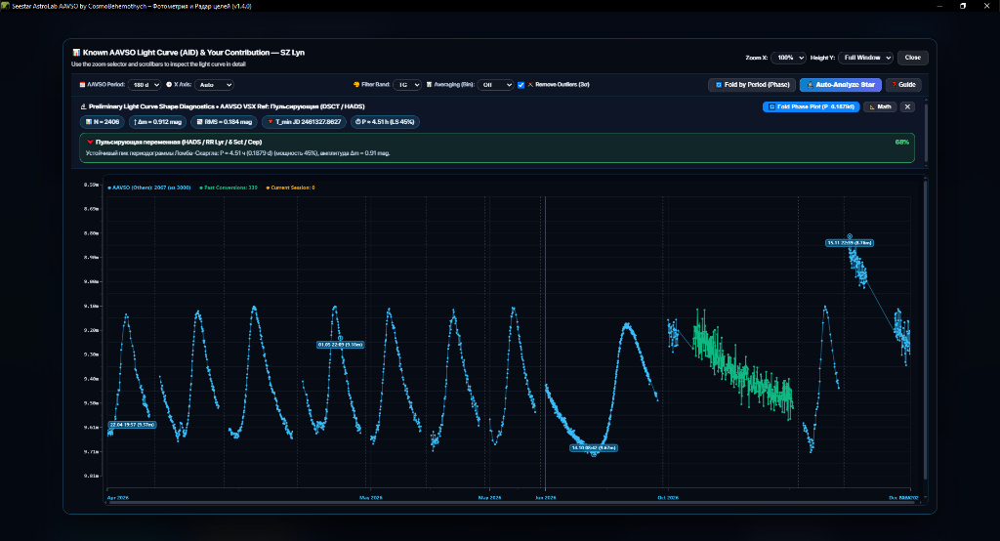

# 🔭 Seestar AstroLab AAVSO (`v1.5.0-alpha`)

[-10b981?style=flat-square)](#-languages--feedback)

> **Turn your ZWO Seestar (`S30`, `S30PRO`, `S50`, `S50PRO`) into a full-featured stellar photometry laboratory: analyze variable stars with built-in mathematical tools, filter out corrupted or saturated frames, and export verified [AAVSO WebObs](https://www.aavso.org/webobs) reports in 15 seconds.**  
> **Important:** We **do NOT send photos or telescope images** — only brightness measurements (small CSV numbers) are submitted to the [AAVSO International Database (AID)](https://www.aavso.org/aavso-international-database-aid).

**[⬇️ Download Latest Release (`v1.5.0-alpha` — Windows Installer)](https://github.com/CosmoBehemothych/Seestar-AstroLab-AAVSO/releases/tag/v1.5.0-alpha)** • **[🛡️ Verify SHA-256 (`VERIFY.txt`)](VERIFY.txt)** • **[🇷🇺 Русская версия ниже](#-русская-версия-russian)**

---

## 🎬 Quick Demo: Photometry Lab, Live Radar & AAVSO Conversion

---

## 🔬 Built-In Stellar Photometry Laboratory (`v1.5.0-alpha`)

In **`v1.4.0`**, Seestar AstroLab evolves from a CSV converter into a **complete photometric analysis laboratory** where you can inspect, clean, and mathematically analyze light curves before submitting data:

* **Lomb–Scargle Periodogram & Phase Folding (`φ ∈ [0, 2]`):** Automatically detects pulsation and orbital periods, displays periodogram confidence, and folds your observations together with up to **3,000** recent [AAVSO AID](https://www.aavso.org/aavso-international-database-aid) points into a clean phase curve.
* **Box Least Squares (BLS) Transit & Eclipse Search:** Scans light curves for periodic dips caused by exoplanet transits or eclipsing binaries and computes `T_min`, duration, and depth.
* **Automatic Curve Diagnostics & Mathematical Audit Protocol:** Calculates amplitude (`Δm`), `RMS`, robust dispersion (`σ MAD`), skewness, and mid-transit JD, and lets you open or copy the step-by-step calculation protocol.
* **Clean Other Observers' Data During Analysis (`>3σ MAD` & Band Filters):** Inside the Light Curve Lab, you can apply the **`>3σ MAD`** outlier filter, time-averaging (binning), and photometric band filters (`TG`, `V`, `CV`, `B`, `R`, `Vis.`) not only to your own frames, but also to **other observers' AAVSO AID measurements** on the chart — removing stray points before computing periods and amplitudes.

---

## 🛡️ Data Quality, Anti-Saturation & `>3σ MAD` Protection

Uploading raw `Magnitude_*.csv` files directly to AAVSO WebObs risks submitting overexposed frames, stray satellite trails, wrong targets, or duplicate nights. Seestar AstroLab protects both you and the AAVSO database:

1. **✂ Automatic `>3σ MAD` Outlier Check Before Conversion (ON by Default)**:
   - Before exporting your CSV, the converter computes the session **median** and robust dispersion (`σ = 1.4826 × MAD`). Unlike a standard mean, a single bad frame (satellite/aircraft trail, passing cloud, tracking slip, or cosmic ray) cannot skew the threshold — outliers beyond `max(0.06 mag, 3 × σ)` are automatically filtered out. A built-in **`?`** guide explains when to keep it active and when to turn it off (for example, during rapid flares or novae).
2. **🛡️ Calibration Guard (3-Layer Pre-Export Check)**:
   - **Zero-Point Shift (`> 0.40 mag`)**: Compares your session median against AAVSO reference observations to catch wrong comparison stars or calibration drift.
   - **Sensor Saturation Risk (`mag_p05 < base_10s(model) + 2.5·log10(EXP / 10)`)**: Evaluates the **brightest 5th percentile** of frames against the selected Seestar model's linearity limit (`S30: 6.4m`, `S30+: 6.2m`, `S30PRO: 6.0m`, `S50: 7.0m`, `S50PRO: 6.8m` at `10s`) scaled by exposure `EXP`, catching saturation at maximum light.
   - **Sparse Reference Stars (`RefStars < 3`)**: Warns when fewer than 3 comparison stars were available in Seestar's ensemble.
   - When triggered, export is soft-locked until you inspect the curve in the Light Curve Lab or confirm a genuine outburst.
3. **Duplicate & Multi-Night Overwrite Protection**:
   - Compares every frame's `JD_Mid` against your local `Converted_Photometry_Storage/` archive and strips already-submitted nights or duplicate timestamps.
4. **Canonical `STARID` & Coordinate Verification (`RA` / `Dec`)**:
   - Normalizes constellation names via **[CDS SIMBAD](https://simbad.cds.unistra.fr/simbad/)** and **[AAVSO VSX](https://www.aavso.org/vsx/)** (`SZ Lyncis` → `SZ Lyn`) and blocks conversion if coordinates differ by `> 0.05°`.
5. **Horizon Altitude (`Alt < 20°` / `Airmass > 2.9`) & Per-Row `MERR` Quality Control**:
   - Automatically rejects invalid rows (`MERR ≥ 1.00m`, `≤ 0`, or `NaN`), warns on noisy frames (`> 0.25m`), and checks horizon altitude with automatic city-timezone verification.
6. **Strict Scientific Honesty (`KNAME=na`, `KMAG=na`)**:
   - Sets `CNAME=ENSEMBLE`, `CMAG=na`, `KNAME=na`, `KMAG=na`, exact `JD_Mid`, and `NOTES ≤ 150` chars.

---

## 📡 Live AAVSO Target Radar & Personal Analytics

* **Always Live — Even Without an API Key:** Out of the box (with no key required), the Target Radar combines a curated core list with **live urgent campaigns fetched automatically from public AAVSO Alert Notices**. Entering a free personal **[AAVSO Target Tool API](https://targettool.aavso.org/TargetTool/api)** key in **⚙️ Settings** expands the radar to the **full live AAVSO catalog (3,000+ active targets)**.
* **Smart Visibility Filtering:** Filters targets by your city's latitude (`|lat - dec| ≤ 70°`, `maxAlt ≥ 20°` in both Northern and Southern hemispheres), balcony azimuth (`N/S/E/W`), telescope magnitude limits, and real-time Sky Clarity ([Open-Meteo](https://open-meteo.com/)) & Moon conditions ([USNO](https://aa.usno.navy.mil/data/api)).
* **📓 My Observations (Sessions & By Star):** Track every converted session in a chronological log or switch to the **By Star** view to inspect total observing time, frames, and filters per target and jump straight into the Light Curve Lab.

---

## 🚀 Getting Started in 3 Simple Steps

1. **⬇️ Download** **`Seestar_AstroLab_Setup_v1.4.0.exe`** (Windows Installer) and **`SHA256SUMS.txt`** from [GitHub Releases](https://github.com/CosmoBehemothych/Seestar-AstroLab-AAVSO/releases/tag/v1.4.0). *(Standalone Windows Installer only — no Python required.)*
2. **▶️ Install & Launch** the app.
3. **🟢 Click `🚀 Getting Started`** in the top bar for a built-in **12-slide visual guide** (plus an **8-slide guide on How to Read Light Curves**) in all **8 languages**.

---

## 📦 Versions & Download

| Version | Status | Download Link | Highlights |
| :--- | :--- | :--- | :--- |
| **`v1.4.0`** | ✨ **Latest Release** | [GitHub Releases (`v1.4.0`)](https://github.com/CosmoBehemothych/Seestar-AstroLab-AAVSO/releases/tag/v1.4.0) | **Built-in Photometry Lab** (Lomb–Scargle, BLS, Phase Folding, Mathematical Audit Protocol), **`>3σ MAD` outlier filtering** (before export & on AAVSO AID charts), **🛡️ Calibration Guard** (zero-point, saturation & `RefStars < 3`), live AAVSO Alert Notices + Target Tool API Radar, and **2-tab My Observations** (`Sessions` + `By Star`) |
| **`v1.3.5`** | 📦 **Previous Release** | [GitHub Releases (`v1.3.5`)](https://github.com/CosmoBehemothych/Seestar-AstroLab-AAVSO/releases/tag/v1.3.5) | Live AAVSO Target Tool API v1.0.0 integration, extended target dossier, and performance improvements |
| **`v1.3.1`** | 📦 **Previous Release** | [GitHub Releases (`v1.3.1`)](https://github.com/CosmoBehemothych/Seestar-AstroLab-AAVSO/releases/tag/v1.3.1) | Standalone Windows Installer + `SHA256SUMS.txt` & `VERIFY.txt`, per-row `MERR` control, horizon altitude check (`Alt < 20°`), symmetric Northern & Southern Hemisphere filtering |

---

## 🔐 Security, Verification & Reproducible Builds

* **Transparent CI Builds & Checksums:** Every release installer is built from public MIT-licensed source code on GitHub-hosted Windows runners ([`.github/workflows/build.yml`](.github/workflows/build.yml)) and published with `SHA256SUMS.txt` and [`VERIFY.txt`](VERIFY.txt).
* **Build from Source & Docs:** See [`BUILD.md`](BUILD.md), [`SECURITY.md`](SECURITY.md), [`CONTRIBUTING.md`](CONTRIBUTING.md), and [`CODE_OF_CONDUCT.md`](CODE_OF_CONDUCT.md).
* **Academic Citation (Zenodo DOI):** Cite all versions via **[`10.5281/zenodo.24402803`](https://doi.org/10.5281/zenodo.24402803)** ([`.zenodo.json`](.zenodo.json)).

---

## 🌐 Languages & Feedback

Available in **8 languages**: English, Russian, Spanish, German, French, Chinese, Czech (`Čeština`), and Berber (`Tamaziɣt`).

> ✉️ **Feedback & Contributions**: Email **[CosmoBehemothych@gmail.com](mailto:CosmoBehemothych@gmail.com)** or open an issue on GitHub.

---

## 📸 Interface Gallery (`v1.4.0`)

### 1. Light Curve Lab (AAVSO AID + Your Seestar `TG` Contribution & Math Diagnostics)

### 2. Live AAVSO Target Radar

### 3. My Observations (By Star & Session Analytics)

### 4. Getting Started (12-Slide Visual Guide)

---

## 🇷🇺 Русская версия (Russian)

> **Превратите ваш ZWO Seestar (`S30`, `S30PRO`, `S50`, `S50PRO`) в полноценную фотометрическую лабораторию: анализируйте переменные звёзды с помощью встроенных математических расчётов, отсеивайте бракованные и пересвеченные кадры и выгружайте проверенные отчёты в [AAVSO WebObs](https://www.aavso.org/webobs) за 15 секунд.**  
> **Важно:** программа **НЕ отправляет фотографии** — в международную базу [AAVSO](https://www.aavso.org) передаются только числовые измерения яркости (CSV).

### 🔬 Что нового в `v1.4.0`: полноценная лаборатория анализа
* **Периодограмма Ломба–Скаргла и фазовая кривая (`φ ∈ [0, 2]`):** программа сама рассчитывает возможный период пульсаций или затмений, показывает его статистическую значимость и сворачивает ваши замеры вместе с данными из базы AAVSO AID (до **3 000** последних точек) на единую фазовую кривую.
* **Поиск транзитов и затмений (BLS) и математический аудит:** встроенные алгоритмы вычисляют амплитуду `Δm`, разброс `RMS`, робастное отклонение `σ MAD`, время минимума `T_min JD` и асимметрию кривой, а весь расчёт можно открыть в окне **«📐 Расчёт»** и скопировать как готовый протокол.
* **Очистка данных на `>3σ MAD` — и для ваших файлов, и для чужих графиков:**
  * **Перед конвертацией файла:** фильтр `>3σ MAD` включён по умолчанию — он находит медиану и устойчивое отклонение `σ = 1.4826 × MAD`, автоматически удаляя случайные выбросы (пролёт спутника, облако, срыв ведения), чтобы в базу AAVSO не попадал мусор.
  * **При анализе звезды в Лаборатории:** точно такую же очистку `>3σ MAD`, усреднение (биннинг) и фильтры полос (`TG`, `V`, `CV`, `B`, `R`, `Vis.`) вы можете применять и к **чужим наблюдениям из базы AAVSO** прямо на графике — убирая чужие случайные промахи ради чистого расчёта периода и кривой блеска.
* **🛡️ Калибровочный сторож (защита от пересвета и сбоев перед экспортом):** проверяет сдвиг нуль-пункта относительно базы AAVSO (`> 0.40 mag`), риск **пересвета матрицы** (`mag + 2.5·log10(EXP)`) и нехватку звёзд сравнения (`RefStars < 3`). Если сработала защита, экспорт мягко блокируется до вашей проверки на графике.
* **📡 Живой Радар целей (работает и без ключа, и с ключом API):** даже **без ввода API-ключа** радар не статичный — он автоматически подгружает свежие срочные кампании из публичных **AAVSO Alert Notices**. А если указать бесплатный личный ключ **[AAVSO Target Tool API](https://targettool.aavso.org/TargetTool/api)** в **⚙️ Настройках**, радар раскрывает весь живой каталог целей AAVSO (3 000+ звёзд).
* **📓 Мои наблюдения в двух разрезах:** список всех сессий и отдельная вкладка **«⭐ По звёздам»** (число ночей, суммарное время, кадры, фильтры) с быстрым переходом к графику любой звезды в Лаборатории.

### 🚀 Быстрый старт за 3 шага
1. **⬇️ Скачайте** **`Seestar_AstroLab_Setup_v1.4.0.exe`** и **`SHA256SUMS.txt`** со страницы [GitHub Releases (`v1.4.0`)](https://github.com/CosmoBehemothych/Seestar-AstroLab-AAVSO/releases/tag/v1.4.0) (Python не требуется).
2. **▶️ Установите и запустите** программу.
3. **🟢 Нажмите `🚀 С чего начать`** (12-слайдовая инструкция) или **«📊 Как читать графики»** (8-слайдовый гид по кривым блеска) на русском языке.

### 🛡️ От каких ещё ошибок защищает конвертер?
1. **Дубли и прошлые ночи:** сверяет `JD_Mid` с локальной базой `Converted_Photometry_Storage/` и исключает уже отправленные кадры.
2. **Имена звёзд и координаты (`RA` / `Dec`):** приводит названия к стандарту IAU/VSX (`SZ Lyncis` → `SZ Lyn`) и блокирует экспорт при расхождении координат `> 0.05°`.
3. **Высота над горизонтом и `MERR`:** отбрасывает кадры с `MERR ≥ 1.00m` и предупреждает о шумных (`> 0.25m`) или низких (`Alt < 20°`) кадрах с проверкой часового пояса города.
4. **Честные поля `KNAME=na`, `KMAG=na`:** не подменяет реальные измерения каталожными значениями.

### 🔐 Безопасность, доверие и цитирование
- Установщик `Seestar_AstroLab_Setup_v1.4.0.exe` не имеет коммерческой цифровой подписи, но собирается открыто в GitHub Actions из исходного кода под лицензией MIT и публикуется с хэшем `SHA-256` ([`VERIFY.txt`](VERIFY.txt)).
- Инструкция по самостоятельной сборке — [`BUILD.md`](BUILD.md), политика безопасности — [`SECURITY.md`](SECURITY.md).
- Для научных ссылок (CERN Zenodo DOI): **[`10.5281/zenodo.24402803`](https://doi.org/10.5281/zenodo.24402803)**.

---

## 🔬 Photometric Methodology, Limitations & Audio License

### How ZWO Seestar Photometry Is Mapped to AAVSO Extended
* **Source calibration:** ZWO Seestar's onboard photometry mode computes instrumental/calibrated `Mag(obs)` and `Mag(err)` via internal ensemble comparison against the Seestar app's built-in star catalog (using `Valid Reference Stars` in the frame).
* **AAVSO Extended headers (`#OBSTYPE=DSLR`, `FILT=TG`, `MTYPE=STD`, `TRANS=NO`):**
  * `FILT=TG` (Tri-color Green) reflects the Bayer green CMOS bandpass of Seestar sensors (IMX462 / IMX585 / IMX662 / SC485SL).
  * `CNAME=ENSEMBLE`, `CMAG=na`, `KNAME=na`, `KMAG=na`: strictly compliant with AAVSO rules because Seestar exports an ensemble solution without an independent check-star measurement.
  * `TRANS=NO`: no user-derived color transformation coefficients are applied.
* **Outlier handling (`>3σ` Rolling MAD):** Uses a **rolling-window median** (9-frame local window) so genuine narrow eclipses (EA), flares, and dwarf nova rises are preserved while isolated satellite/cloud spikes are flagged. Auto-removal on export is **OFF by default** and requires explicit user confirmation.
* **Known Limitations:**
  * **Dual-Band LP Filter:** Must be **OFF** (IR-cut only) when collecting scientific AAVSO photometry — the current 19-column ZWO Seestar CSV does not export filter state or internal stack count (if ZWO adds these columns in future firmware, the header-based parser automatically appends them to `NOTES`).
  * **Internal Stacking & Bright-Star Linearity:** Watch the Calibration Guard (`p05` saturation check) and avoid stars brighter than `base_10s(model) + 2.5·log10(EXP / 10)`.
* **Comparison with AstroImageJ & VPhot:**
  | Criterion | Seestar AstroLab AAVSO | AstroImageJ / VPhot |
  | :--- | :--- | :--- |
  | **Input** | Raw Seestar Photometry CSV (zero-script) | Calibrated FITS frames |
  | **Best For** | Rapid AAVSO TG submissions, target planning, multi-night monitoring, quick Lomb–Scargle/BLS checks | High-precision differential/transformed photometry, custom apertures, independent check-star (`KNAME`/`KMAG`) reporting |
  | **Color Transforms** | `TRANS=NO` (onboard Seestar ensemble) | Full `B/V/R/I` or `TB/TG/TR` transform support |

### Audio Asset License (`jackpot_track.mp3`)
* `Source_and_Build/pwa_mobile_and_electron/assets/jackpot_track.mp3` is **original AI-generated audio created by the repository author (CosmoBehemothych)** and is distributed under the repository's **MIT License** with no third-party copyright encumbrances.

### Методология фотометрии, ограничения и лицензия аудио (RU)
* **Калибровка и формат AAVSO Extended:** Seestar рассчитывает `Mag(obs)` ансамблем по встроенному каталогу приложения ZWO; в отчёт AAVSO записываются `#OBSTYPE=DSLR`, `FILT=TG` (зелёный канал Байера), `MTYPE=STD`, `CNAME=ENSEMBLE`, `KNAME=na`, `KMAG=na`, `TRANS=NO`.
* **Защита от выбросов и пересвета:** детектор выбросов использует **скользящую медиану** (окно 9 кадров) и **отключён по умолчанию при экспорте** (только подсветка и удаление по подтверждению), чтобы не срезать минимумы затменных и вспышки. Насыщение проверяется по **5-му процентилю ярчайших точек** по формуле `base_10s(model) + 2.5·log10(EXP / 10)`.
* **Ограничения:** для научной фотометрии AAVSO встроенный LP-фильтр Seestar должен быть **выключен** (в текущем 19-колоночном CSV ZWO не выгружает состояние LP-фильтра и число кадров стэка; при их появлении в новых прошивках парсер по заголовкам автоматически добавит их в `NOTES`). Для задач с индивидуальным подбором апертур, контрольной звездой (`KNAME`/`KMAG`) и цветовыми трансформациями используйте **AstroImageJ** или **VPhot**.
* **Лицензия `jackpot_track.mp3`:** аудиофайл создан лично автором репозитория (`CosmoBehemothych`) с помощью нейросети и распространяется под лицензией **MIT** без прав третьих лиц.
