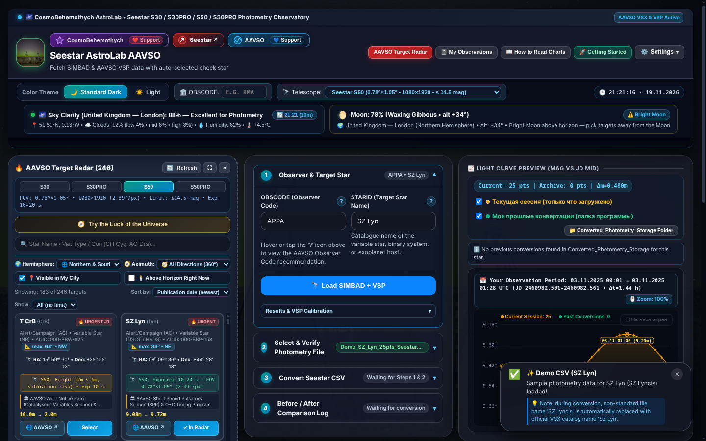
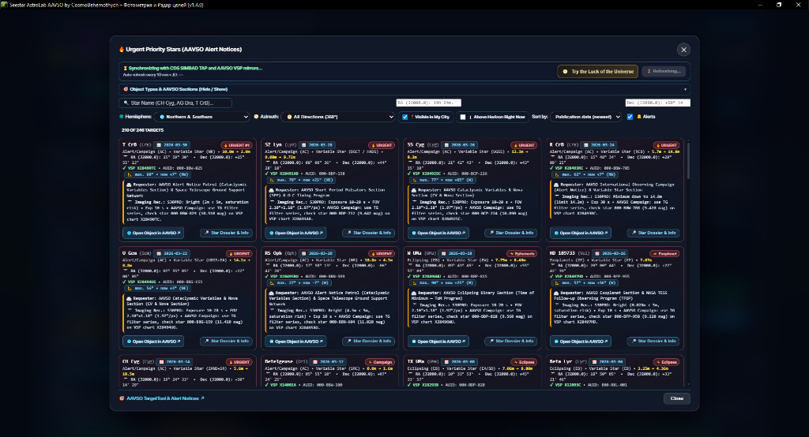

# 🔭 Seestar AstroLab AAVSO (`v1.2.1`)

**What is this program and why do you need it?**  
If you own a **ZWO Seestar (`S30`, `S30PRO`, `S50`, `S50PRO`)**, your telescope can do more than take pretty space photos — it can measure how bright stars are so real astrophysicists can use your numbers in scientific research.  
**Important:** You **do NOT send photos or image frames** to anyone — you only upload a small **CSV table with star brightness measurements (photometry data)** to [AAVSO](https://www.aavso.org).

> **🇷🇺 [Русская версия ниже](#-русская-версия-russian)**

---

## 💡 What Problems Does This App Solve for You?

1. **Tells You WHICH Stars Scientists Need Tonight**: Instead of guessing what to shoot, you get a ready list of **246 urgent stars** that astronomers are waiting for. Filter out stars you cannot see from your balcony or backyard in 2 clicks.
2. **Gives Ready Coordinates for Your Seestar**: Click any star and immediately see the **exact coordinates (`RA` / `Dec`) that you can type straight into your Seestar app** to point the telescope quickly, plus the recommended exposure (`10s` or `10–20s`) so bright stars do not overexpose.
3. **Turns Your Seestar CSV Into an Accepted AAVSO Report**: If you try to upload Seestar's raw `Magnitude_*.csv` file directly to AAVSO, the website rejects it with an error. This app automatically fixes the format, adds the required reference star data, and saves a ready `.csv` report.
4. **Shows Your Results on a Brightness Graph**: Right after loading your CSV file, you see your star's brightness curve next to measurements from other observers around the world.

---

## 📦 Versions on GitHub Releases

| Version | Status | Download | What's Inside |
| :--- | :--- | :--- | :--- |
| **`v1.2.1`** | ✨ **Latest Release** | [GitHub Releases (`v1.2.1`)](https://github.com/CosmoBehemothych/Seestar-AstroLab-AAVSO/releases/tag/v1.2.1) | Full-page green **Getting Started** 12-slide guide (8 languages), installer-matched first-launch language, **Czech (`cs`)** localization, 246-target urgent star monitor & Portable fix |
| **`v1.1.2 beta`** | 🧪 **Previous Beta** | [GitHub Releases (`v1.1.2-beta`)](https://github.com/CosmoBehemothych/Seestar-AstroLab-AAVSO/releases/tag/v1.1.2-beta) | Hemisphere & balcony direction filters, Sky Clarity & Moon indicator, 246-target list |

> **Why earlier versions were removed:** Releases prior to `v1.1.2 beta` were removed due to a critical startup defect — on clean Windows PCs they failed to launch (`Fatal Error in Launcher` / missing `pythonw.exe` and external `pywebview`/`pythonnet` libraries, as well as `ERR_FILE_NOT_FOUND` URI issues). Starting with **`v1.2.1`**, all dependencies are bundled directly inside a standalone self-contained executable that runs out of the box with no Python installation required.

---

## ⚙️ How Your Raw Seestar CSV Is Converted & Enriched

1. **Step 1 — Automatic Star & Reference Lookup**:
   - Enter your free [AAVSO](https://www.aavso.org) observer code (`OBSCODE`) and star name (or pick a star from the urgent list).
   - The app connects to **[CDS SIMBAD](https://simbad.cds.unistra.fr/simbad/)**, **[AAVSO VSX](https://www.aavso.org/vsx/)**, and **[AAVSO VSP](https://app.aavso.org/vsp/)** to verify the star's exact coordinates and automatically fills in the official chart ID (`CHART`) and a stable comparison star (`KNAME` / `KMAG`) that fits inside your Seestar model's field of view.
2. **Step 2 — Checking Your Raw Seestar CSV**:
   - Load the `Magnitude_*.csv` file produced by Seestar's built-in Photometry mode (green channel `TG`, `Non-reference star` rows).
   - The app calculates the exact mid-exposure time (`JD_Mid`), removes duplicate timestamps you already converted earlier, and draws your brightness graph alongside **[AAVSO AID](https://www.aavso.org/aavso-international-database-aid)** data.
3. **Step 3 — Saving the Ready Report**:
   - Rounds brightness and error numbers to 4 decimals, adds all required AAVSO headers (`#TYPE=EXTENDED`, `#OBSCODE`, telescope model, `TG` filter, `CHART`, `KNAME`/`KMAG`), and saves a clean `*_Seestar.csv` file ready to upload to **[AAVSO WebObs](https://www.aavso.org/webobs)**.

---

## 🚀 Built-In "Getting Started" Guide (For Complete Beginners)

Never done photometry before? Click the green **🚀 Getting Started** button in the top bar to open a full-page, 12-slide visual guide (available in all **8 languages**):
1. Why your observations matter → 2. Getting your free [AAVSO](https://www.aavso.org/user/register) `OBSCODE` → 3. Turning on **EQ Mode** on Seestar → 4. Picking an urgent star → 5. Recording a `10s` photometry series → 6. Copying `Magnitude_*.csv` to your PC → 7. Converting it in 3 clicks → 8. Uploading your `.csv` data table to [AAVSO WebObs](https://apps.aavso.org/v2/data/submit/photometry/).

---

## 🌐 Languages, Feedback & Localization Requests

Available in **8 languages**: **English**, **Russian (`Русский`)**, **Spanish (`Español`)**, **German (`Deutsch`)**, **French (`Français`)**, **Chinese (`中文`)**, **Czech (`Čeština`)**, and **Berber (`Tamaziɣt / Берберский (para Ramón)`)**.  
The language you pick during installation is used on the first launch, and any change you make in Settings is saved for future launches.

> ✉️ **Feedback & New Languages**: I am happy to add more languages and would greatly appreciate constructive criticism and suggestions. If you want a language that is not yet in Settings, please write to **[CosmoBehemothych@gmail.com](mailto:CosmoBehemothych@gmail.com)** — I will do my best to take all constructive feedback into account.

---

## 🛡️ Windows SmartScreen Notice (Unsigned Open-Source Build)

When launching the Windows installer or Portable file for the first time, **Windows Defender SmartScreen** may show a standard warning (*"Windows protected your PC"*). This happens because the application currently has no paid code-signing certificate/license — a free open-source license can only be obtained once the program becomes more popular. So we are waiting and hoping! 🙂  
All source code is open and built via GitHub Actions: simply click **More info → Run anyway**.

---

## 📸 Screenshots (`v1.2.1`)

### 1. Main Workspace & Converter (Main Menu)
The primary dashboard brings together your telescope selector (`S30`–`S50PRO`), local **Sky Clarity & Moon** conditions, the **Target Radar** dock on the left, the **4-step CSV converter** in the center, and live **Light Curve** & **SIMBAD/AAVSO verification** on the right.  

### 2. Urgent Stars (AAVSO Priority Targets)
Browse **246 urgent AAVSO targets** with automatic 10-minute online updates, filterable by your city's horizon, hemisphere, balcony azimuth, and Seestar model limits (`S30`–`S50PRO`), with ready J2000 coordinates and exposure hints.  

### 3. My Observations (Personal Analytics)
Track your personal photometry history across all sessions: total observing minutes, frame counts, an activity trend chart, and filterable logs by date, star name, and Seestar model.  

### 4. Getting Started: Citizen Photometry with Seestar & AAVSO
A full-page, 12-slide visual guide (available in all **8 languages**) walking beginners step by step from registering a free AAVSO `OBSCODE` and shooting `EQ Mode` photometry to uploading the finished CSV report to WebObs.  

### 5. AAVSO Light Curve (AID) & Your Seestar Contribution
Inspect your newly loaded **Seestar** measurements (orange) plotted directly alongside historical and recent observations from other **AAVSO** observers worldwide (blue) so you can immediately see how your data complements the international light curve.  

---

## 🇷🇺 Русская версия (Russian)

**Зачем нужна эта программа простыми словами?**  
Если у вас есть умный телескоп **ZWO Seestar (`S30`, `S30PRO`, `S50`, `S50PRO`)**, вы можете не только снимать красивые туманности, но и помогать реальным астрофизикам. Учёным нужно знать, как меняется яркость определённых звёзд прямо сейчас — и Seestar умеет это измерять.  
**Важно:** мы **НЕ отправляем фотографии или кадры** с телескопа — в международную базу [AAVSO](https://www.aavso.org) отправляются **только цифры яркости (данные фотометрии) в виде небольшого CSV-файла**.

> **Почему удалены более ранние версии:** Предыдущие сборки (до `v1.1.2 beta`) были удалены из-за критического дефекта — приложение не запускалось на компьютерах пользователей (`Fatal Error in Launcher`, отсутствие системного `pythonw.exe` и библиотек `pywebview`/`pythonnet`, а также ошибка пути `ERR_FILE_NOT_FOUND`). В версии **`v1.2.1`** все библиотеки встроены внутрь единого автономного `.exe`, и программа запускается сразу на любом ПК с Windows без установки Python.

### 💡 Какие задачи решает программа?
1. **Показывает, какие звёзды срочно нужны науке сегодня ночью**: в программе уже собраны **246 приоритетных звёзд** от AAVSO. В пару кликов можно скрыть звёзды, которые не видны с вашего балкона или двора, и оставить только подходящие под вашу модель Seestar.
2. **Даёт готовые координаты для быстрого наведения Seestar**: откройте любую звезду — и вы сразу увидите точные координаты (`RA` / `Dec`), которые можно ввести прямо в приложение Seestar для быстрого наведения, а также подсказку по выдержке (`10 с` или `10–20 с`), чтобы звезда не пересветилась.
3. **Готовит CSV-файл так, чтобы его принял сайт AAVSO**: если загрузить «сырой» файл `Magnitude_*.csv` из Seestar напрямую на сайт AAVSO, сайт выдаст ошибку. Программа сама проверяет данные, добавляет нужные параметры и сохраняет правильный файл.
4. **Рисует понятный график яркости**: вы сразу видите, как менялся блеск звезды во время вашей съёмки, и можете сравнить свой график с данными других наблюдателей мира.

### ⚙️ Как программа обрабатывает и обогащает ваш CSV-файл?
1. **Раздел 1 (Проверка звезды и автоподбор карты)**: по вашему коду наблюдателя `OBSCODE` и названию звезды программа обращается к каталогам **[CDS SIMBAD](https://simbad.cds.unistra.fr/simbad/)**, **[AAVSO VSX](https://www.aavso.org/vsx/)** и **[AAVSO VSP](https://app.aavso.org/vsp/)**, уточняет координаты и сама подбирает номер карты (`CHART`) и проверочную звезду (`KNAME`/`KMAG`), подходящую под поле зрения вашего Seestar.
2. **Раздел 2 (Чтение сырого CSV из Seestar)**: программа берёт файл `Magnitude_*.csv` (зелёный канал `TG`, строки `Non-reference star`), точно вычисляет середину каждой экспозиции (`JD_Mid`), удаляет дублирующиеся строки измерений, которые вы уже отправляли ранее, и строит график рядом с базой **[AAVSO AID](https://www.aavso.org/aavso-international-database-aid)**.
3. **Раздел 3 (Сохранение готового отчёта)**: округляет яркость и погрешность до 4 знаков, подставляет ваш `OBSCODE`, модель телескопа, фильтр `TG`, карту `CHART`, проверочную звезду и сохраняет готовый файл `*_Seestar.csv` для загрузки на **[AAVSO WebObs](https://www.aavso.org/webobs)**.

### 🚀 Встроенная инструкция «С чего начать»
Если вы никогда не занимались фотометрией, нажмите зелёную кнопку **🚀 С чего начать** вверху окна. Откроется полноэкранная 12-слайдовая инструкция с картинками (на всех 8 языках), которая по шагам проведёт вас от бесплатной регистрации на [aavso.org](https://www.aavso.org/user/register) и съёмки на Seestar до загрузки готового CSV-отчёта на сайт AAVSO.

### 🌐 Языки и обратная связь
Программа переведена на **8 языков**: английский, русский, испанский, немецкий, французский, китайский, **чешский (`Čeština`)** и берберский (`Tamaziɣt / Берберский (para Ramón)`). Язык, выбранный в установщике, включается при первом запуске, а далее запоминается выбор из Настроек.

> ✉️ **Обратная связь и новые языки**: я готов расширять перечень языков для локализации и буду очень благодарен за конструктивную критику и предложения. Если вы хотите видеть в настройках язык, которого ещё нет в программе — напишите на почту **[CosmoBehemothych@gmail.com](mailto:CosmoBehemothych@gmail.com)**, постараюсь учесть все конструктивные пожелания.

### 🛡️ Предупреждение Windows SmartScreen при запуске
При запуске установщика Windows может показать уведомление (*«Система Windows защитила ваш компьютер»*), поскольку у данного приложения пока нет платной лицензии (сертификата подписи кода). Бесплатную лицензию для open-source проекта можно получить, только если программа станет более популярной — так что ждём и надеемся 🙂  
Весь исходный код открыт и собирается через GitHub Actions: нажмите **«Подробнее» → «Выполнить в любом случае»**.

### 📸 Скриншоты интерфейса (`v1.2.1`)

1. **Основное меню и рабочий стол конвертера** — единый экран с выбором модели Seestar, погодой и фазой Луны, боковым радаром целей, пошаговым конвертером и графиком блеска ([скриншот](screenshots/01_main_dashboard_and_converter.png)).
2. **Звёзды с пометкой «Срочно» (Приоритетные цели AAVSO)** — 246 актуальных целей с автообновлением каждые 10 минут, фильтрами по вашему городу, полушарию, стороне света (балкону) и готовыми координатами для наведения ([скриншот](screenshots/02_urgent_stars_priority_targets.png)).
3. **Мои наблюдения** — личная статистика ваших фотометрических сессий, график активности по датам и журнал конвертированных файлов ([скриншот](screenshots/03_my_observations_analytics.png)).
4. **С чего начать: Гражданская фотометрия с Seestar и база AAVSO** — полноэкранная 12-слайдовая инструкция на 8 языках от регистрации `OBSCODE` до загрузки CSV в AAVSO WebObs ([скриншот](screenshots/04_getting_started_guide.png)).
5. **Кривая блеска AAVSO (AID) и ваш вклад** — наложение ваших замеров с Seestar (оранжевый) на кривую блеска других наблюдателей мира из базы AAVSO (синий), наглядно показывающее, как ваши данные дополняют общую кривую ([скриншот](screenshots/05_aavso_light_curve_combined.png)).

---

## 👨‍💻 Authorship & License

Created by **CosmoBehemothych** ([GitHub](https://github.com/CosmoBehemothych/Seestar-AstroLab-AAVSO)) • MIT License.
