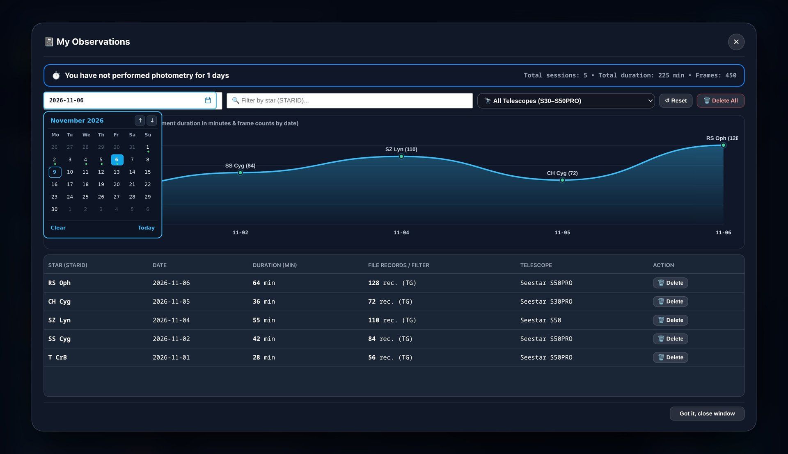
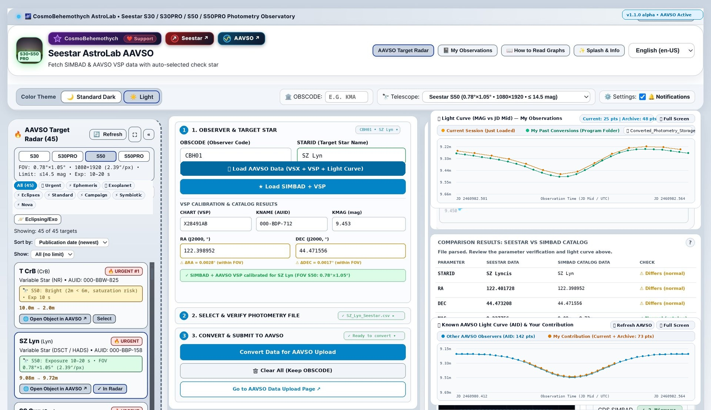
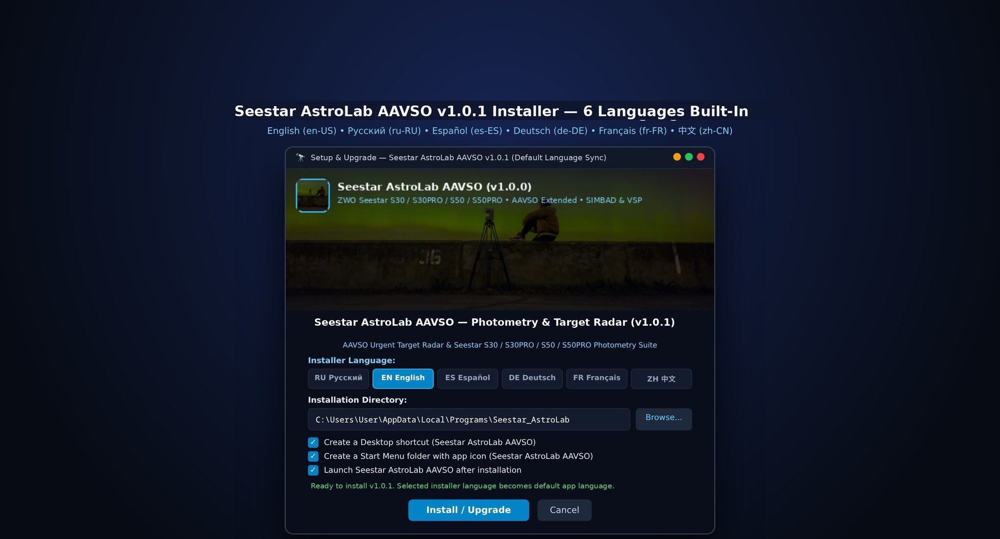

# 🔭 Seestar AstroLab AAVSO (v1.0.0 — Первая версия)

**Seestar AstroLab AAVSO** — специализированное десктопное приложение для владельцев умных телескопов **ZWO Seestar (`S30`, `S30PRO`, `S50`, `S50PRO`)** и наблюдателей переменных звёзд [AAVSO (American Association of Variable Star Observers)](https://www.aavso.org).

Программа устраняет технический барьер между встроенным инструментом фотометрии телескопов [ZWO Seestar](https://www.seestar.com) и научной базой данных [AAVSO WebObs](https://www.aavso.org/webobs): она автоматически переводит сырые фотометрические CSV-файлы Seestar в международный научный стандарт **AAVSO Extended**, сверяет координаты и идентификаторы звёзд через [CDS SIMBAD](https://simbad.cds.unistra.fr/simbad/) и [AAVSO VSP (Variable Star Plotter)](https://app.aavso.org/vsp/), автоматически подбирает оптимальную контрольную звезду (`Check Star`: `KNAME` / `KMAG`) в поле зрения конкретной модели Seestar, строит кривую блеска и включает интерактивный **Радар срочных целей AAVSO (`Alert Notices`)** и личный трекер прогресса **«Мои наблюдения»**.

---

## 📸 Скриншоты интерфейса (Screenshots)

### 1. Главная панель, конвертер фотометрии Seestar → AAVSO Extended и кривая блеска (Тёмная тема)

### 2. Интерактивный Радар срочных целей AAVSO (`Alert Notices` & Priority Targets)

### 3. Раздел «Мои наблюдения» (Автологирование сессий и сглаженный HiDPI-график прогресса)

### 4. Светлая тема и мультиязычный интерфейс (Light Theme)

### 5. Локализованное меню установщика на 6 языках (`RU | EN | ES | DE | FR | ZH`)

---

## 🔍 Ключевые возможности (RU)

* **Прямая конвертация ZWO Seestar CSV → AAVSO Extended**: автоматический пересчёт середины экспозиции в юлианскую дату (`JD_Mid = (JD_Start + JD_End) / 2`), фильтрация целевых измерений (`Non-reference star`), округление инструментального блеска `MAG` и погрешности `MERR` в полосе `TG` до 4 знаков после запятой и формирование валидного заголовка `#TYPE=EXTENDED` с вашим кодом `#OBSCODE`.
* **Адаптация под все 4 модели телескопов ZWO Seestar**:
  * **Seestar S30** (`FOV 1.28°×0.72°`, рабочий предел фотометрии до `13.5 mag`)
  * **Seestar S30PRO** (`FOV 2.10°×1.18°`, 4K сенсор, до `14.2 mag`)
  * **Seestar S50** (`FOV 0.78°×1.05°`, до `14.5 mag`)
  * **Seestar S50PRO** (`FOV 1.15°×0.65°`, 4K сенсор, до `15.2 mag`)
* **Параллельная синхронизация с каталогами CDS SIMBAD, VizieR и AAVSO VSP**: автоматическая редукция латинских названий созвездий по стандарту МАС (IAU 88 constellations, например `SZ Lyncis` → `SZ Lyn`), загрузка официального идентификатора карты (`CHART ID`) и автоматический подбор непеременной контрольной звезды (`KNAME`, `KMAG`) в поле зрения выбранного телескопа (с автономным офлайн-резервом при работе в поле без интернета).
* **Радар срочных запросов AAVSO (`Звёзды с пометкой «Срочно»`)**: встроенный каталог приоритетных целей AAVSO (повторные новые `T CrB`, `RS Oph`, катаклизмические и симбиотические переменные `SS Cyg`, `CH Cyg`, `U Gem`, короткопериодические пульсирующие звёзды `SZ Lyn` и др.) с фильтрацией под проницающую способность вашей модели Seestar.
* **Постоянное сохранение `OBSCODE` и базы «Мои наблюдения»**: нативный мост хранения Windows (`AstroLabDiskBridge`) атомарно сохраняет ваш код обсерватории `OBSCODE`, историю сконвертированных файлов, выбранный язык и тему в `%APPDATA%\Seestar_AstroLab\user_persistent_store.json`. Данные гарантированно сохраняются после закрытия программы и при установке обновлений поверх.
* **Полная локализация программы и установщика на 6 языков**: Русский (`ru-RU`), English (`en-US`), Español (`es-ES`), Deutsch (`de-DE`), Français (`fr-FR`) и 中文 (`zh-CN`).

---

## 📋 Пошаговая инструкция пользователя (От съёмки на Seestar до отправки в AAVSO WebObs)

### Шаг 1. Установка и первый запуск (Windows 10 / 11)
1. Скачайте установщик **`Seestar_AstroLab_Setup.exe`** из раздела [Releases](https://github.com/CosmoBehemothych/Seestar-AstroLab-AAVSO/releases) (или распакуйте архив релиза).
2. Запустите `Seestar_AstroLab_Setup.exe`, выберите удобный язык установщика (`RU Русский`, `EN English`, `ES Español`, `DE Deutsch`, `FR Français`, `ZH 中文`) и нажмите **«Установить / Обновить»**.
   * *Примечание по безопасности и путям*: Установщик работает в пользовательском контуре (`PrivilegesRequired=lowest`, без запроса прав администратора UAC) и устанавливает приложение в `%LOCALAPPDATA%\Programs\Seestar_AstroLab`, создавая ярлык **Seestar AstroLab AAVSO** на Рабочем столе и папку с 3 ярлыками в меню «Пуск» (`Seestar AstroLab AAVSO`, `Seestar AstroLab AAVSO Web`, `Удалить Seestar AstroLab AAVSO`).
3. Также доступна портативная сборка `Portable/Seestar_AstroLab_Portable.exe` (не требует установки) и автономный веб-интерфейс `Source_and_Build/pwa_mobile_and_electron/index.html`.

### Шаг 2. Настройка профиля наблюдателя (1 раз)
1. В верхней панели выберите модель вашего телескопа (`S30`, `S30PRO`, `S50` или `S50PRO`).
2. В блоке **«Наблюдатель и звезда»** введите ваш официальный код наблюдателя AAVSO в поле **`OBSCODE`** (например, `CBH01`). Поле сохраняется на жёсткий диск мгновенно при вводе и остаётся заполненным при всех последующих запусках программы.

### Шаг 3. Выбор цели и автоподбор контрольной звезды (`Check Star`)
1. Выберите приоритетную звезду в левой панели **«Радар целей AAVSO»** (нажав кнопку **«Выбрать»** на карточке объекта) или введите название звезды вручную в поле **`STARID`** (например, `SZ Lyn`, `T CrB` или `SS Cyg`).
2. Программа автоматически нормализует название по стандарту МАС, параллельно опросит зеркала [CDS SIMBAD](https://simbad.cds.unistra.fr/simbad/) и [AAVSO VSP API](https://app.aavso.org/vsp/), проверит координаты `RA/DEC (J2000)` и автоматически заполнит поля:
   * **`CHART ID`** — идентификатор официальной фотометрической карты AAVSO;
   * **`KNAME`** и **`KMAG`** — оптимальная непеременная контрольная звезда (`Check Star`) в поле зрения вашей матрицы Seestar.

### Шаг 4. Конвертация CSV-файла Seestar и отправка в AAVSO WebObs
1. Перетащите (Drag-and-Drop) или выберите через кнопку **«Выбрать CSV-файл Seestar»** сырой файл фотометрии, выгруженный из приложения ZWO Seestar.
2. Проверьте автоматически построенную **кривую блеска** (`JD Mid` vs `MAG ± MERR`) и таблицу предпросмотра справа.
3. Нажмите кнопку **«Конвертировать и скачать файл AAVSO Extended»**:
   * Готовый отчёт `.csv` в стандарте `#TYPE=EXTENDED` сохранится на ваш компьютер;
   * Сессия автоматически запишется в раздел **«Мои наблюдения»** и обновит график вашего личного прогресса.
4. Перейдите на портал [AAVSO WebObs — Upload File](https://www.aavso.org/webobs) (страница откроется автоматически, после конвертации файла) и загрузите созданный `.csv`-файл.

---

## 🌐 Overview & Quick Start (English — SEO Summary)

**Seestar AstroLab AAVSO** is an open desktop photometry suite for **ZWO Seestar (`S50`, `S50PRO`, `S30`, `S30PRO`)** smart telescopes that bridges the gap between Seestar's built-in photometry output and official [AAVSO WebObs](https://www.aavso.org/webobs) scientific submissions.

* **1-Click Seestar CSV to AAVSO Extended Conversion**: Automatically filters `Non-reference star` rows, calculates mid-exposure Julian Date (`JD Mid`), rounds instrumental `TG` magnitudes and uncertainties (`MAG`, `MERR`) to 4 decimal places, and generates a compliant `#TYPE=EXTENDED` report.
* **Automated SIMBAD & AAVSO VSP Calibration**: Queries [CDS SIMBAD](https://simbad.cds.unistra.fr/simbad/) and the [AAVSO Variable Star Plotter (VSP) API](https://app.aavso.org/vsp/) in parallel to verify `RA/DEC (J2000)` coordinates, retrieve the official `CHART ID`, and automatically select an optimal non-variable Check Star (`KNAME`, `KMAG`) tailored to your Seestar model's field of view (`S30`, `S30PRO`, `S50`, `S50PRO`).
* **AAVSO Urgent Target Radar & Personal Progress Tracker**: Browse urgent AAVSO Alert Notices (`T CrB`, `SS Cyg`, `SZ Lyn`, `RS Oph`, `CH Cyg`, `U Gem`) and track your cumulative photometry sessions with a persistent local database and smooth HiDPI spline chart in **"My Observations"**.
* **6-Language Installer & App UI**: Full localization for both the installer menu (`Seestar_AstroLab_Setup.exe`) and the application interface in **Russian (`ru-RU`)**, **English (`en-US`)**, **Spanish (`es-ES`)**, **German (`de-DE`)**, **French (`fr-FR`)**, and **Simplified Chinese (`zh-CN`)**.

---

## 🏷️ Ключевые слова для поиска (Search Keywords / Topics)

`seestar` `aavso` `zwo-seestar` `seestar-s50` `seestar-s30` `seestar-s50pro` `seestar-s30pro` `aavso-extended` `photometry` `variable-stars` `simbad` `aavso-vsp` `light-curve` `astronomy` `astrophotography` `citizen-science` `фотометрия` `переменные-звезды` `телескоп-seestar`

---

## ❤️ Авторство и поддержка проекта

* **Разработчик**: **CosmoBehemothych** ([https://github.com/CosmoBehemothych](https://github.com/CosmoBehemothych))
* **Цифровой отпечаток авторства (Anti-Plagiarism Fingerprint)**: `CBH-ASTROLAB-AAVSO-2026-9F8E4A21-7C3D-B601` (подробная документация по верификации подлинности — в файле [`AUTHORSHIP_AND_COPYRIGHT_PROOF.md`](Source_and_Build/docs/AUTHORSHIP_AND_COPYRIGHT_PROOF.md))
* **Поддержать развитие проекта на Boosty**: [https://boosty.to/cosmobehemothych](https://boosty.to/cosmobehemothych)
