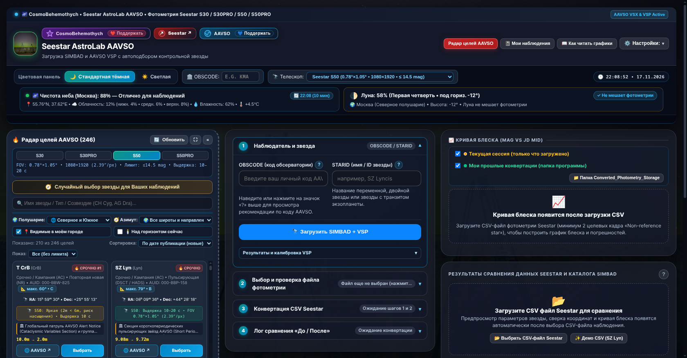
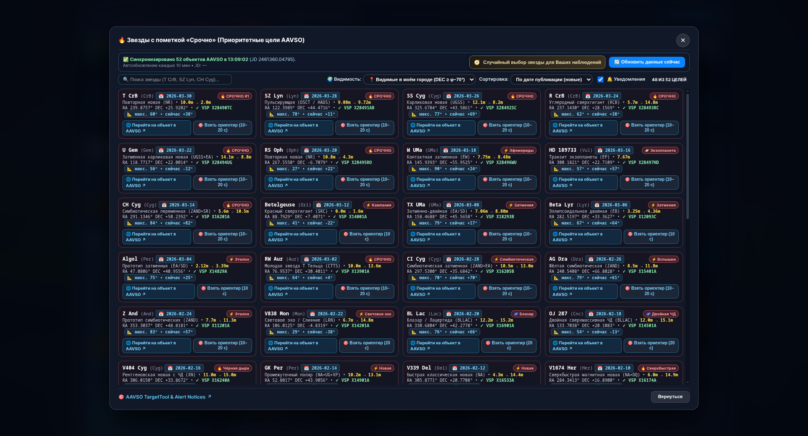
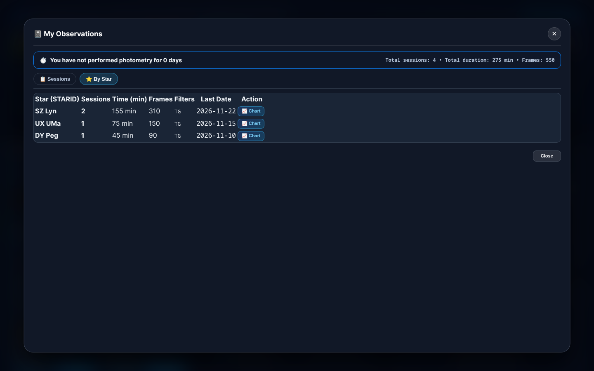
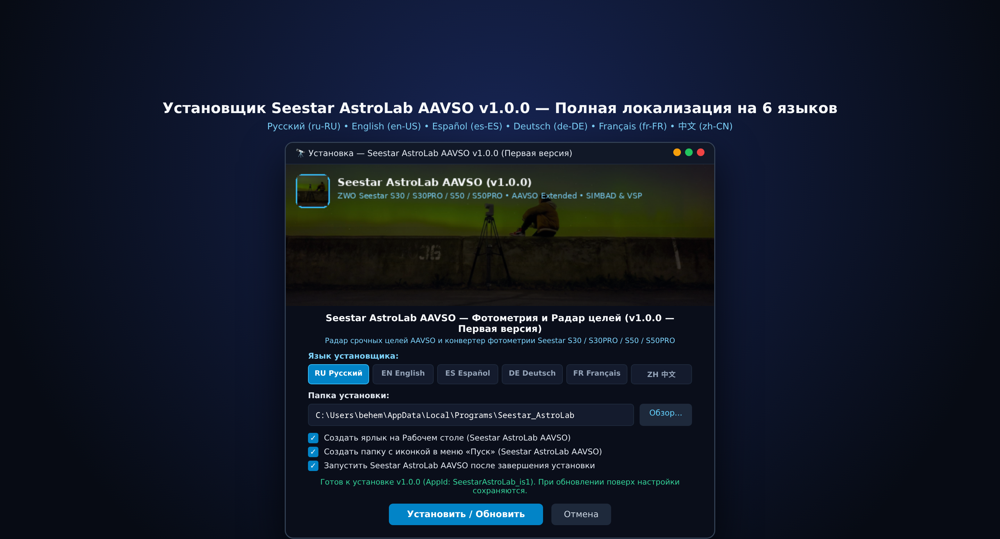
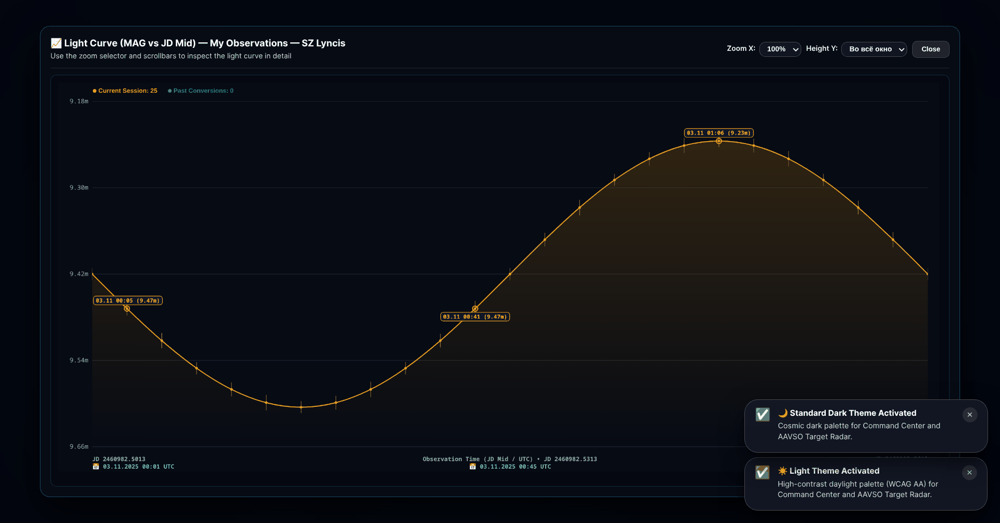

# 🔭 Seestar AstroLab AAVSO (`v1.1.0 beta` & `v1.0.1 Stable`)

🌟 **Seestar AstroLab AAVSO** is a specialized desktop application for owners of **ZWO Seestar smart telescopes (`S30`, `S30PRO`, `S50`, `S50PRO`)** and variable star observers affiliated with the [AAVSO (American Association of Variable Star Observers)](https://www.aavso.org).

The program bridges the technical gap between the built-in photometry tool of [ZWO Seestar](https://www.seestar.com) telescopes and the scientific [AAVSO WebObs](https://www.aavso.org/webobs) & [AAVSO International Database (AID)](https://www.aavso.org/aavso-international-database-aid): it automatically converts raw Seestar photometric CSV files into the international **AAVSO Extended** standard, verifies star coordinates and identifiers via [AAVSO VSX](https://www.aavso.org/vsx/), [AAVSO VSP (Variable Star Plotter)](https://app.aavso.org/vsp/), and [CDS SIMBAD](https://simbad.cds.unistra.fr/simbad/), automatically selects the optimal check star (`Check Star`: `KNAME` / `KMAG`) within the field of view of each Seestar model, plots multi-layer light curves with horizontal mouse-drag panning and a static magnitude axis, maintains a local archive of all your converted sessions (`Converted_Photometry_Storage/`), monitors real-time **Sky Clarity** ([Open-Meteo API](https://open-meteo.com/)) and **Regional Moon Phase & Altitude** ([USNO Astronomical API v4.0](https://aa.usno.navy.mil/data/api)) every 10 minutes, filters priority targets by your observer hemisphere and city latitude, and includes an interactive **Celestial Wheel Random Star Selector**.

## 📦 Version Selection (Both Versions Available on GitHub)

We preserve all previous releases in the [GitHub Releases](https://github.com/CosmoBehemothych/Seestar-AstroLab-AAVSO/releases) section and repository so every observer can choose the version that best fits their workflow:

| 🏷️ Version | 📌 Status | ⬇️ Installer / Portable Package | 🔍 Summary | 
| ----- | ----- | ----- | ----- | 
| **`v1.1.0 beta`** | 🧪 **New Feature Release (Beta)** | [Seestar_AstroLab_Setup_v1.1.0-beta.exe](https://github.com/CosmoBehemothych/Seestar-AstroLab-AAVSO/releases/tag/v1.1.0-beta) / [Portable (GitHub Releases)](https://github.com/CosmoBehemothych/Seestar-AstroLab-AAVSO/releases) | Direct AAVSO (`VSX` + `VSP` + `AID`) integration, 52 priority targets with Hemisphere & City Latitude visibility filtering, live Sky Clarity (Open-Meteo, 10-min auto-refresh) & Regional Moon Phase/Altitude (USNO API) in the header, Celestial Black-Hole & Rocket Random Star Selector (scope- & latitude-aware), 2 independent light-curve engines with static-Y mouse drag, full-screen viewer, `Converted_Photometry_Storage` archive, and English-default 6-language installer | 
| **`v1.0.0` / `v1.0.1`** | ✅ **Classic Initial Release** | [Available in GitHub Releases (v1.0.0)](https://github.com/CosmoBehemothych/Seestar-AstroLab-AAVSO/releases/tag/v1.0.0) | Original initial release with SIMBAD + VSP synchronization, basic Seestar CSV → AAVSO Extended conversion, and basic target radar | 

## 📑 Table of Contents

* [📦 Version Selection](#-version-selection-both-versions-available-on-github)

* [🚀 What's New in v1.1.0 beta (Compared to GitHub v1.0.0)](#-whats-new-in-v110-beta-compared-to-github-v100)

* [📸 Screenshots (`v1.1.0 beta`)](#-screenshots-v110-beta)

* [✨ Key Features](#-key-features)

* [🔭 Supported Seestar Models](#-supported-seestar-models)

* [🧭 Step-by-Step Guide](#-step-by-step-guide-from-seestar-imaging-to-aavso-webobs-submission)

* [👨‍💻 Authorship & Support](#-authorship--support)

* [🇷🇺 Русская версия (Russian Version)](#-русская-версия-russian-version)

## 🚀 What's New in `v1.1.0 beta` (Compared to GitHub `v1.0.0`)

1. **🛰️ Direct AAVSO (`VSX` + `VSP` + `AID`) Integration & Full 52-Target Priority Sync**:

   * Prioritizes official [AAVSO VSX](https://www.aavso.org/vsx/) and [AAVSO VSP](https://app.aavso.org/vsp/) catalogs for target star identification, coordinates (`RA/DEC J2000`), comparison/check star selection (`CHART`, `KNAME`, `KMAG`), and full batch synchronization of all 52 priority targets without truncation.

2. **🌌 Live Sky Clarity (Every 10 Min) & Regional Moon Phase / Altitude in the Header**:

   * **Sky Clarity Widget ([Open-Meteo Forecast & Geocoding API](https://open-meteo.com/en/docs))**: displays live sky clarity (`100% − cloud_cover%`, plus low/mid/high cloud layers, humidity, and temperature) for your selected city (with built-in presets such as Cheboksary, Moscow, St. Petersburg, Kazan, Cambridge, London, Sydney, plus instant search for any city worldwide), automatically refreshing every 10 minutes.

   * **Regional Moon Phase & Topocentric Altitude Widget ([USNO Astronomical Applications API v4.0.1](https://aa.usno.navy.mil/data/api))**: calculates the current lunar phase, illuminated fraction (`%`), hemisphere-correct crescent orientation (Northern vs. Southern Hemisphere), and real-time topocentric altitude of the Moon above or below the horizon in your city.

3. **🌍 Hemisphere & City Latitude Visibility Filtering (`DEC ≥ φ − 70°` & Real-Time `Alt ≥ 15°`)**:

   * Filters priority targets in both the **AAVSO Target Radar**, the **Urgent Stars Modal**, and the **Random Star Selector** according to your city's latitude (`φ`) and Local Sidereal Time (`LST`):

     * `📍 Observable from My City (DEC ≥ φ − 70°)` — automatically excludes deep-southern targets (e.g., Australian targets from Cheboksary) that never reach working photometric altitude (`≥ 20°`);

     * `🕯️ Above Horizon Right Now (Alt ≥ 15°)` — filters targets currently above `15°` altitude at the exact minute of observation;

     * `⬆️ Northern Hemisphere` / `⬇️ Southern Hemisphere` / `🌍 All Latitudes`.

4. **🧭 Celestial Wheel Random Star Selector («Случайный выбор звезды для Ваших наблюдений»)**:

   * Styled as an obsidian-and-gold astronomical drum at the center of a **Black Hole** with the **Sun and Planets** on the background, the **AAVSO Logo** at the center, and an upward-pointing **Golden Rocket**.

   * Strictly filters candidate stars by both your **selected Seestar model (`S30`, `S30PRO`, `S50`, `S50PRO`)** and your **city's hemisphere/latitude**, shuffling 12 unique abbreviated star names via a cryptographic Fisher–Yates algorithm.

   * Spins for **10 seconds** with custom soundtrack integration (`10_Grand_Finale_Jackpot.mp3`): **1st click** on the drum stops the spin early and locks the star; **2nd click** starts a new spin.

5. **📈 Two Independent Scientific Light Curve Panels with Static-Y Mouse Drag**:

   * **Panel 1 — `📈 Light Curve (MAG vs JD Mid) — My Observations`**: displays exclusively your own photometry — **Current Session** (`#f59e0b` amber) and **My Past Conversions** from `Converted_Photometry_Storage/` (`#10b981` emerald green).

   * **Panel 2 — `📊 Known AAVSO Light Curve (AID) & Your Contribution`**: displays **Other AAVSO Observers** from [AAVSO AID](https://www.aavso.org/aavso-international-database-aid) (`#38bdf8` cyan) alongside **Your Contribution**.

   * Left-mouse-button dragging pans smoothly along the time axis (`JD / UTC`) at any zoom level (`100%`–`1600%`) while keeping the vertical brightness scale (`MAG` on the Y-axis) strictly static (`offsetY = 0`), with **`⛶ Full Screen`** buttons pinned to the top-right corner of both charts.

6. **🌐 English Default Language in the 6-Language Installer**:

   * `Seestar_AstroLab_Setup.exe` and `Seestar_AstroLab_Installer.iss` launch in **English (`EN English`)** by default before the user selects their preferred language (`EN | RU | ES | DE | FR | ZH`).

## 📸 Screenshots (`v1.1.0 beta`)

### 1. Main dashboard, live Sky Clarity & Moon Phase header bar, Hemisphere visibility filter, and dual light curves (Dark theme)

### 2. Interactive AAVSO Urgent Target Radar (`52 Priority Targets`, Hemisphere filter & Random Star Selection button)

### 3. Celestial Wheel Random Star Selector (Black Hole, AAVSO Center Emblem, Upward Rocket & Obsidian-Gold Star Dossier)

### 4. "My Observations" section & `Converted_Photometry_Storage` analytics

### 5. Harmonized Light theme and multilingual interface (`Light Theme`)

### 6. Installer menu localized into 6 languages (`EN English` selected by default)

### 7. Full-screen scrollable light curve analysis (`SZ Lyn` — full-window mode)

## ✨ Key Features

* 🔄 **Direct ZWO Seestar CSV → AAVSO Extended conversion**: automatically calculates mid-exposure Julian Date (`JD_Mid = (JD_Start + JD_End) / 2`), filters target measurements (`Non-reference star`), rounds instrumental `MAG` and uncertainty `MERR` in the `TG` band to 4 decimal places, and generates a valid `#TYPE=EXTENDED` header with your `#OBSCODE`.

* 🔭 **Adapted for all 4 ZWO Seestar models**:

  * **Seestar S30** — FOV `1.28°×0.72°`, photometry limit up to `13.5 mag`

  * **Seestar S30PRO** — FOV `2.10°×1.18°`, 4K sensor, up to `14.2 mag`

  * **Seestar S50** — FOV `0.78°×1.05°`, up to `14.5 mag`

  * **Seestar S50PRO** — FOV `1.15°×0.65°`, 4K sensor, up to `15.2 mag`

* 🛰️ **Synchronization with AAVSO VSX, AAVSO VSP, AAVSO AID, and CDS SIMBAD**: automatic reduction of Latin constellation names according to IAU standards (e.g., `SZ Lyncis` → `SZ Lyn`), retrieval of the official chart identifier (`CHART ID`), and automatic selection of a non-variable check star (`KNAME`, `KMAG`).

* 🌌 **Real-time Sky Clarity & Regional Moon Phase monitoring**: automatic 10-minute updates for any city via [Open-Meteo API](https://open-meteo.com/) and [USNO Astronomical API v4.0](https://aa.usno.navy.mil/data/api).

* 🌍 **Full localization of the application and installer into 6 languages**: English (`en-US`, default in installer), Russian (`ru-RU`), Spanish (`es-ES`), German (`de-DE`), French (`fr-FR`), and Chinese (`zh-CN`).

## 🔭 Supported Seestar Models

| 🔭 Model | 📐 Field of View (FOV) | 🌟 Photometry Limit | 
| ----- | ----- | ----- | 
| Seestar S30 | 1.28° × 0.72° | up to 13.5 mag | 
| Seestar S30PRO | 2.10° × 1.18° | up to 14.2 mag | 
| Seestar S50 | 0.78° × 1.05° | up to 14.5 mag | 
| Seestar S50PRO | 1.15° × 0.65° | up to 15.2 mag | 

## 🧭 Step-by-Step Guide (From Seestar Imaging to AAVSO WebObs Submission)

1. ⬇️ **Install or Run Portable**: Run **`Seestar_AstroLab_Setup_v1.1.0-beta.exe`** (English is active by default; switch to `RU | EN | ES | DE | FR | ZH` in one click) or launch **`Portable/Seestar_AstroLab_Portable_v1.1.0-beta.exe`**.

2. 📍 **Select Your City & Telescope**: In the top bar, choose your city (e.g., `Чебоксары (56.1°N)` or search any city) to see live **Sky Clarity (`%`)**, **Moon Phase & Altitude**, and select your telescope (`S30`, `S30PRO`, `S50`, `S50PRO`).

3. ⭐ **Pick a Target Star**: Use the **AAVSO Target Radar** (filtered automatically to stars observable from your city's latitude) or click **«🧭 Random Star Selection for Your Observations»** to spin the 10-second Celestial Wheel.

4. 📊 **Convert & Upload**: Load your Seestar CSV file in Section 2, inspect both light curves (`My Observations` and `Known AAVSO Light Curve & Your Contribution`), click **«Convert Data for AAVSO Upload»**, and upload the generated `#TYPE=EXTENDED` file to [AAVSO WebObs](https://www.aavso.org/webobs).

## 👨‍💻 Authorship & Support

* 🧑‍🚀 **Developer**: **CosmoBehemothych** ([https://github.com/CosmoBehemothych](https://github.com/CosmoBehemothych))

* 🛡️ **Anti-Plagiarism Fingerprint**: `CBH-ASTROLAB-AAVSO-2026-9F8E4A21-7C3D-B601` (see [AUTHORSHIP_AND_COPYRIGHT_PROOF.md](Source_and_Build/docs/AUTHORSHIP_AND_COPYRIGHT_PROOF.md))

* ☕ **Support the project on Boosty**: [https://boosty.to/cosmobehemothych](https://boosty.to/cosmobehemothych)

* 💙 **Support the AAVSO mission**: <https://aavso.org/donate-now/>

## 🇷🇺 Русская версия (Russian Version)

> 📸 Все обновлённые скриншоты интерфейса `v1.1.0 beta` приведены выше в разделе [📸 Screenshots (`v1.1.0 beta`)](#-screenshots-v110-beta).

🌟 **Seestar AstroLab AAVSO** — специализированное десктопное приложение для владельцев умных телескопов **ZWO Seestar (`S30`, `S30PRO`, `S50`, `S50PRO`)** и наблюдателей переменных звёзд [AAVSO (American Association of Variable Star Observers)](https://www.aavso.org).

### 📦 Выбор удобной версии на GitHub (Сохранены обе версии)

При обновлении репозитория старая версия **не удаляется** — в разделе [Releases на GitHub](https://github.com/CosmoBehemothych/Seestar-AstroLab-AAVSO/releases) и в дереве репозитория доступны обе сборки:

| 🏷️ Версия | 📌 Статус | ⬇️ Установщик / Portable-сборка | 🔍 Описание версии | 
| ----- | ----- | ----- | ----- | 
| **`v1.1.0 beta`** | 🧪 **Новая расширенная сборка (Beta)** | [Seestar_AstroLab_Setup_v1.1.0-beta.exe](https://github.com/CosmoBehemothych/Seestar-AstroLab-AAVSO/releases/tag/v1.1.0-beta) / [Portable (GitHub Releases)](https://github.com/CosmoBehemothych/Seestar-AstroLab-AAVSO/releases) | Прямая интеграция с AAVSO (`VSX` + `VSP` + `AID`), 52 приоритетные цели с фильтрацией по полушарию и широте города, живая Чистота неба (Open-Meteo, каждые 10 мин) и Фаза/Высота Луны по региону (USNO API) в шапке, барабан случайного выбора звезды в центре чёрной дыры с ракетой и логотипом AAVSO, 2 графика кривой блеска со статичной осью Y при сдвиге ЛКМ, хранилище `Converted_Photometry_Storage` и английский по умолчанию в установщике | 
| **`v1.0.0` / `v1.0.1`** | ✅ **Классическая первая версия** | [Доступна в разделе Releases (v1.0.0)](https://github.com/CosmoBehemothych/Seestar-AstroLab-AAVSO/releases/tag/v1.0.0) | Базовая первоначальная версия с синхронизацией SIMBAD + VSP и классическим конвертером CSV → AAVSO Extended | 

### 🚀 Что нового в версии `v1.1.0 beta`

1. **🛰️ Полная синхронизация 52 приоритетных объектов AAVSO (`VSX` + `VSP` + `AID`)**:

   * Устранена ошибка обрезки списка при обновлении (`.slice(0, 35)`): теперь синхронизируются все **52 приоритетные цели кампаний AAVSO**, а все 8 категорий фильтров Радара (`Срочно`, `Эфемериды`, `Экзопланета`, `Затмения`, `Эталон`, `Кампания`, `Симбиотическая`, `Новая`) охватывают 100% объектов каталога.

2. **🌌 Расширенная двухколоночная панель «Чистота неба» и «Луна» во всю ширину шапки + Автоопределение города в «⚙️ Настройках»**:

   * **Автоматическое определение города обсерватории**: при запуске программа автоматически определяет ваш город и координаты (с сохранением выбора в `localStorage` и резервным профилем `Чебоксары 56.13°N, 47.25°E`), а ручной селектор и поиск города перенесены внутрь меню **«⚙️ Настройки»** (расположенного сразу за кнопкой **«📖 Как читать графики»** вместе с блоком **«📡 Статус каталогов»**).

   * **Эргономичный верхний ряд управления**: сразу за переключателем **«Цветовая панель»** расположены быстрый ввод **`🏛️ OBSCODE`** и селектор профиля **`🔭 Телескоп`** (`S30`, `S30PRO`, `S50`, `S50PRO`).

   * **Два широких информативных блока на всю вторую строку (без необходимости наведения курсора)**: левый блок в реальном времени отображает процент чистого неба, оценку условий для фотометрии, облачность по ярусам (`нижн. / средн. / верхн.`), влажность, температуру и таймер 10-минутной синхронизации ([Open-Meteo IFS 9 км](https://open-meteo.com/en/docs)); правый блок отображает фазу Луны, процент освещённости диска, топоцентрическую высоту Луны над/под горизонтом в градусах и вердикт влияния лунной засветки на фотометрию ([USNO API v4.0.1](https://aa.usno.navy.mil/data/api)).

   * **Виджет чистоты неба ([Open-Meteo Forecast & Geocoding API](https://open-meteo.com/en/docs))**: показывает процент чистого неба (`100% − облачность%`), облачность по ярусам (нижний/средний/верхний), влажность и температуру в выбранном городе (Чебоксары по умолчанию для RU, Москва, Санкт-Петербург, Казань и др., плюс поиск любого населённого пункта мира) с автообновлением каждые **10 минут**.

   * **Виджет фазы и топоцентрической высоты Луны ([USNO Astronomical Applications API v4.0.1](https://aa.usno.navy.mil/data/api))**: рассчитывает текущую фазу Луны, процент освещённости диска, правильную ориентацию серпа для Северного и Южного полушарий и текущую высоту Луны над или под горизонтом в выбранном городе.

3. **🌍 Фильтрация приоритетных звёзд под полушарие и широту вашего города (`DEC ≥ φ − 70°` и `Alt ≥ 15°`)**:

   * В Радаре целей, модальном окне «Срочно» и барабане случайного выбора добавлен фильтр видимости:

     * `📍 Видимые в моём городе (DEC ≥ φ − 70°)` — автоматически отсекает южные звёзды (например, объекты неба Австралии при наблюдениях из Чебоксар), которые никогда не поднимаются на рабочую фотометрическую высоту (`≥ 20°`);

     * `🕯️ Над горизонтом сейчас (Alt ≥ 15°)` — оставляет только те звёзды, которые находятся выше `15°` над горизонтом в вашем городе прямо в текущую минуту;

     * `⬆️ Северное полушарие` / `⬇️ Южное полушарие` / `🌍 Все широты`.

   * На каждой карточке звезды отображается бейдж высоты кульминации и текущей высоты (`📐 макс. +XX° • сейчас +YY°`).

4. **🧭 Барабан «Случайный выбор звезды для Ваших наблюдений»**:

   * Чёрно-золотой барабан в центре **чёрной дыры** на фоне **Солнца и планет**, с эмблемой **AAVSO** в центре и направленной строго вверх **золотой ракетой**; в 12 медальонах отображаются уникальные сокращённые названия звёзд, подходящих одновременно и под выбранный телескоп (`S30`–`S50PRO`), и под широту вашего города.

   * Время вращения — **10 секунд** под встроенный трек `10_Grand_Finale_Jackpot.mp3`: **первый клик** по барабану досрочно останавливает вращение и открывает досье звезды (в едином чёрно-золотом стиле), **второй клик** запускает вращение заново.

5. **📈 Два независимых графика кривых блеска со статичной осью блеска `MAG` и полупрозрачной кнопкой `⛶ На весь экран` внутри полотна графика**:

   * Кнопки **«⛶ На весь экран»** размещены непосредственно в правом верхнем углу обоих графиков и в обычном состоянии полупрозрачны (`opacity: 0.28`), чтобы не перекрывать кривую блеска при чтении, становясь полностью контрастными (`opacity: 1.0`) при наведении курсора мыши.

   * Статичный космический фон барабана случайного выбора звезды (Чёрная дыра, аккреционный диск, Солнце, Сатурн и планеты) предкэшируется в отдельный графический буфер (`_cachedWheelBgCanvas`), обеспечивая плавное вращение на **60 FPS** без микрофризов.

   * Перемещение обоих графиков зажатием левой кнопки мыши работает на любом масштабе (включая `100%`) вдоль оси времени (`JD / UTC`), при этом вертикальный уровень блеска (`MAG`) остаётся строго статичным (`offsetY = 0`).

### ❤️ Авторство и поддержка проекта

* 🧑‍🚀 **Разработчик**: **CosmoBehemothych** ([https://github.com/CosmoBehemothych](https://github.com/CosmoBehemothych))

* 🛡️ **Цифровой отпечаток авторства**: `CBH-ASTROLAB-AAVSO-2026-9F8E4A21-7C3D-B601` ([AUTHORSHIP_AND_COPYRIGHT_PROOF.md](Source_and_Build/docs/AUTHORSHIP_AND_COPYRIGHT_PROOF.md))

* ☕ **Поддержать автора на Boosty**: [https://boosty.to/cosmobehemothych](https://boosty.to/cosmobehemothych)

* 💙 **Поддержать ассоциацию AAVSO**: <https://aavso.org/donate-now/>

## Code signing policy

Free code signing provided by [SignPath.io](https://signpath.io/), certificate by [SignPath Foundation](https://signpath.org/).

### Team roles
- **Authors and Reviewers:** [CosmoBehemothych](https://github.com/CosmoBehemothych)
- **Approvers:** [CosmoBehemothych](https://github.com/CosmoBehemothych)

## Privacy policy

This program will not transfer any personal or telemetry information to other networked systems unless specifically requested by the user or the person installing or operating it.

When using online astronomical and weather features, the application sends read-only queries to public third-party services (AAVSO, CDS SIMBAD, Open-Meteo, and USNO) using only the target coordinates, star identifiers, or city selected by the user.

## Uninstallation

You can uninstall the application at any time via Windows **Settings → Apps → Installed apps** (or **Control Panel → Programs and Features**).
