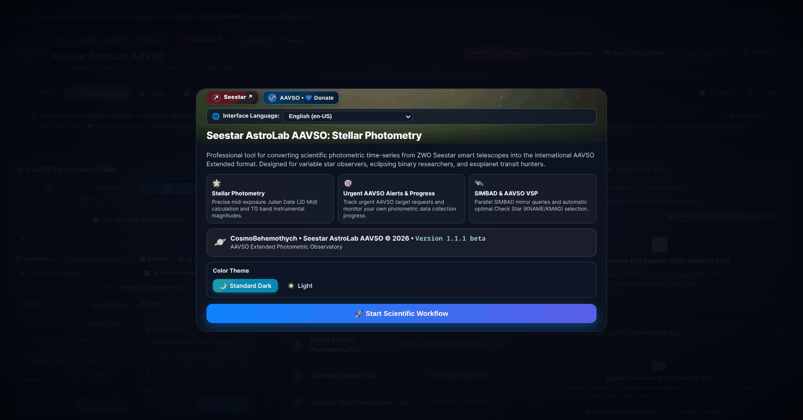
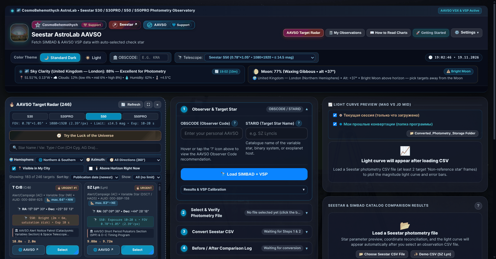
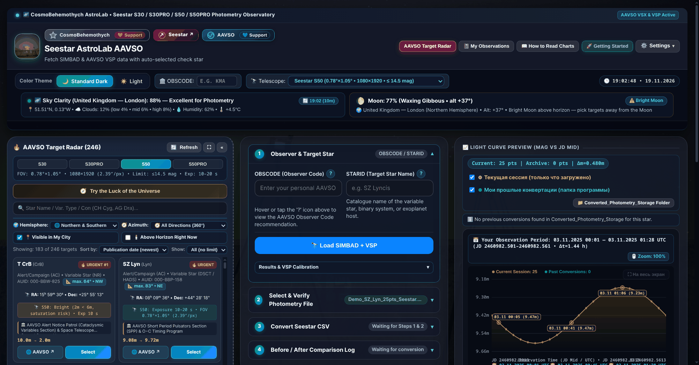
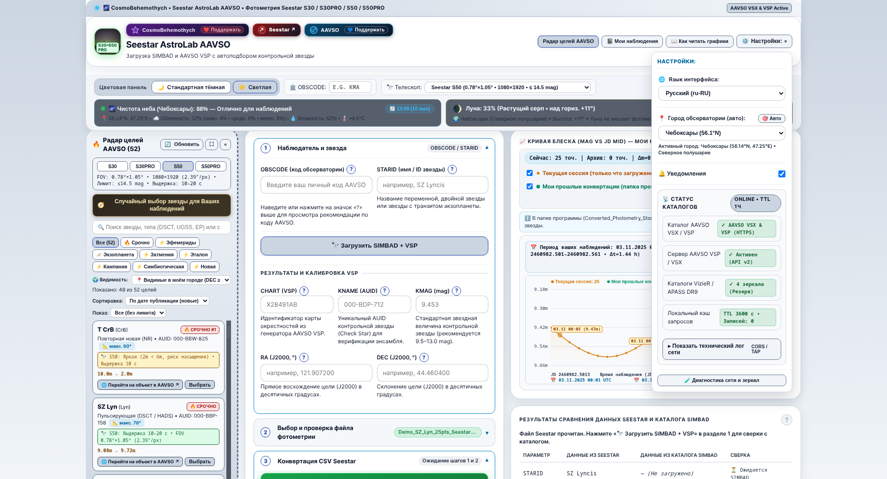

# 🔭 Seestar AstroLab AAVSO (`v1.2.1`)

**Seestar AstroLab AAVSO** is a desktop photometry workstation for **ZWO Seestar (`S30`, `S30PRO`, `S50`, `S50PRO`)** smart telescope owners and variable star observers. It converts raw Seestar `Magnitude_*.csv` logs into the international **AAVSO Extended (`.csv`)** format, verifies targets via [AAVSO VSX](https://www.aavso.org/vsx/), [AAVSO VSP](https://app.aavso.org/vsp/), and [CDS SIMBAD](https://simbad.cds.unistra.fr/simbad/), auto-selects Check Stars (`KNAME`/`KMAG`), plots interactive light curves, and includes a **246-target AAVSO Radar**.

> **🇷🇺 [Русская версия ниже](#-русская-версия-russian)**

---

## 📦 Versions on GitHub Releases

| Version | Status | Download | Highlights |
| :--- | :--- | :--- | :--- |
| **`v1.2.1`** | ✨ **Latest Release** | [GitHub Releases (`v1.2.1`)](https://github.com/CosmoBehemothych/Seestar-AstroLab-AAVSO/releases/tag/v1.2.1) | Full-page green **Getting Started** 12-slide course (7 languages), first-launch EN + persistent user language, 2-level `Country → City` selector, pink Berber (`para Ramón`), 60–144 FPS Celestial Wheel & fixed Portable build |
| **`v1.1.2 beta`** | 🧪 **Previous Beta** | [GitHub Releases (`v1.1.2-beta`)](https://github.com/CosmoBehemothych/Seestar-AstroLab-AAVSO/releases/tag/v1.1.2-beta) | Split Hemisphere & Azimuth filters, Sky Clarity & Moon Phase header bar, 246-target Radar |

---

## ✨ Core Features

- **🚀 Full-Page "Getting Started" Guide (12 Slides, 7 Languages)**: Step-by-step citizen photometry course from [AAVSO](https://www.aavso.org/user/register) `OBSCODE` registration and Seestar EQ-mode capture to `.csv` conversion and [AAVSO WebObs](https://www.aavso.org/webobs) upload.
- **⚡ 3-Step Photometry Converter**: Section 1 (`OBSCODE`, `STARID`, SIMBAD + VSP auto-fill) → Section 2 (Seestar `Magnitude_*.csv` validation & duplicate JD filtering) → Section 3 (`#TYPE=EXTENDED` `.csv` export + local `Converted_Photometry_Storage/` archive).
- **🎯 246-Target AAVSO Radar & Celestial Wheel**: Filter by Seestar model (`S30`–`S50PRO`), Hemisphere, Azimuth, City visibility, and current altitude, or spin the 60–144 FPS Celestial Wheel.
- **🌦️ Live Sky Clarity & Regional Moon Phase**: Automatic 10-minute updates from [Open-Meteo](https://open-meteo.com/) and [USNO API](https://aa.usno.navy.mil/data/api) with a 20-country / 85+ city `Country → City` selector.
- **🌐 7 Languages & Themes**: English (first-launch default, user choice saved thereafter), Russian, Spanish, German, French, Chinese, and Berber (`Tamaziɣt / Берберский (para Ramón)`); Dark & Light themes.

---

## 📸 Screenshots (`v1.2.1`)

### 1. Welcome Hub & Main Workspace (Target Radar + 3-Step Converter + Light Curves)

### 2. Photometry Verification, Light Theme & Full-Screen Light Curve

### 3. Celestial Wheel Random Star Selector

---

## 🇷🇺 Русская версия (Russian)

**Seestar AstroLab AAVSO (`v1.2.1`)** — настольная программа для владельцев телескопов **ZWO Seestar (`S30`, `S30PRO`, `S50`, `S50PRO`)**, автоматизирующая подготовку фотометрических наблюдений для [AAVSO](https://www.aavso.org).

### Основной функционал
- **🚀 Полноэкранный раздел «С чего начать» (12 слайдов на 7 языках)**: пошаговое руководство — от регистрации на [aavso.org](https://www.aavso.org/user/register) и получения `OBSCODE` до съёмки в EQ-режиме, конвертации `Magnitude_*.csv` и загрузки на [AAVSO WebObs](https://www.aavso.org/webobs).
- **⚡ Конвертер в AAVSO Extended (`.csv`)**: Раздел 1 (`OBSCODE`, `STARID`, автозагрузка SIMBAD + VSP и Check Star) → Раздел 2 (проверка `Magnitude_*.csv` и фильтр дублей) → Раздел 3 (сохранение `*_Seestar.csv` и архив `Converted_Photometry_Storage/`).
- **🎯 Радар 246 целей AAVSO и Колесо выбора звезды (60–144 FPS)**: фильтрация по модели Seestar, полушарию, азимуту, видимости в городе и высоте над горизонтом.
- **🌦️ Чистота неба и фаза Луны**: обновление каждые 10 минут для любого города мира через двухуровневый выбор `Страна → Город` (20 стран, 85+ городов) или автоопределение.
- **🌐 7 языков и 2 темы**: английский по умолчанию только при первом запуске (далее сохраняется выбор пользователя), русский, испанский, немецкий, французский, китайский и берберский (`Tamaziɣt (para Ramón)`).

---

## 👨‍💻 Authorship & License

Created by **CosmoBehemothych** ([GitHub](https://github.com/CosmoBehemothych/Seestar-AstroLab-AAVSO)) • MIT License.
